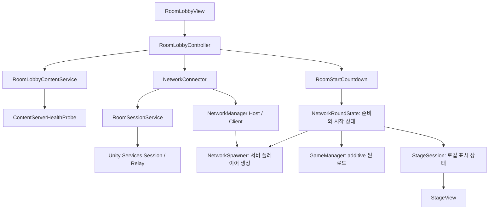
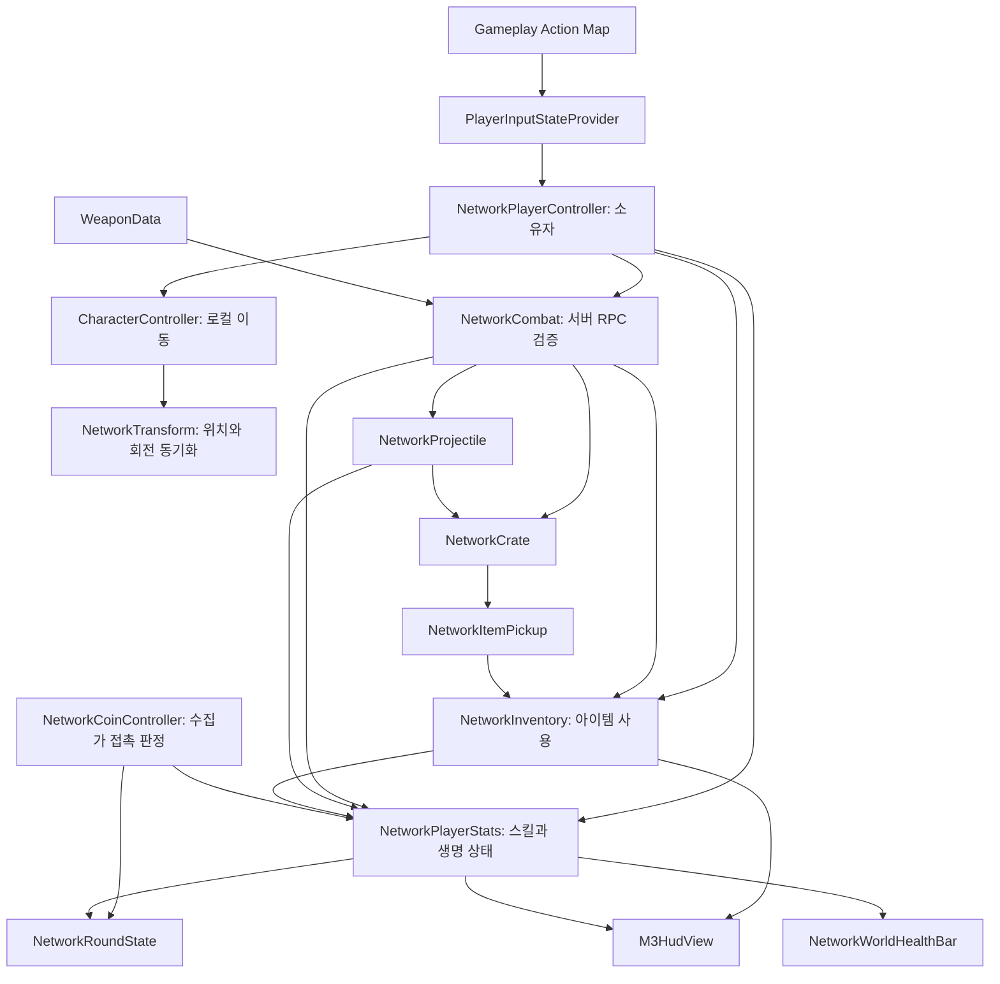

# CoinGame 게임 기획서 (GDD)

> 이 문서는 AI 코딩 에이전트(Codex)가 Unity 프로젝트를 구현할 때 참조하는 기획서입니다.
> - `[확정]` = 기획자가 정한 사양. 임의로 바꾸지 말 것.
> - `[제안]` = 기획 보강안. 구현 시 기본값으로 사용하되, 모든 수치는 ScriptableObject/설정 파일로 분리해 쉽게 조정 가능하게 할 것.
> - `[미정]` = 결정이 필요한 항목. 기본 가정값으로 구현하고 TODO 주석을 남길 것.

---

## 1. 개요

| 항목 | 내용 |
|---|---|
| 게임 제목 | **CoinGame** |
| 장르 | 탑뷰 캐주얼 슈팅 아케이드 `[확정]` |
| 플랫폼 | PC, 모바일 `[확정]` |
| 타깃 유저 | 10대 `[확정]` |
| 아트 방향 | 스타일라이즈 카툰풍 `[확정]` |
| 엔진 / 파이프라인 | Unity 6.7f1, URP `[확정]` |

### 한 줄 소개 `[확정]`
코인 수집가는 스테이지마다 남은 코인을 모두 먹으며 마지막 스테이지까지 살아남으면 승리하고, 코인 방해자는 수집가를 방해하며 전원을 처치하면 승리하는 비대칭 대전 게임.

### 핵심 재미 요소 `[확정]`
- 초반에는 코인 방해자에게 쫓기기만 하지만, 스테이지를 통과할 때마다 아이템으로 강해져 상황을 뒤집는 **역전의 재미**.

### 디자인 필러 `[제안]`
1. **쫓기다가 사냥하는 쾌감**: 수집가의 성장 곡선이 가장 큰 재미. 초반은 도망/생존, 후반은 반격 가능.
2. **짧고 직관적인 라운드**: 10대 유저 대상, 한 판 5~8분 내외.
3. **긴장과 코미디의 균형**: 폭력 표현은 코믹하고 가볍게(피 표현 없음, 쓰러지면 "기절" 연출 등).
4. **한 판 안에서 계속 오는 선택**: 어떤 상자를 깰지, 어떤 아이템을 쓸지, 코인을 먼저 먹을지 도망칠지.

---

## 2. 역할 및 승패 조건

### 2.1 역할 `[확정]`
| 역할 | 목표 | 승리 조건 | 패배 조건 |
|---|---|---|---|
| 코인 수집가 (Collector) | 스테이지마다 남은 코인을 전부 수집 | 마지막 스테이지까지 **1명이라도 생존** | 수집가 **전원 사망** |
| 코인 방해자 (Disruptor) | 수집가 방해 및 처치 | 마지막 스테이지까지 **수집가 전원 처치** | 마지막 스테이지 종료 시 수집가가 1명이라도 생존 |

### 2.2 승패 처리 세부 규칙 `[제안]`
- **스테이지 클리어**: 해당 스테이지의 코인을 모두 수집하면 클리어. 생존 중인 수집가가 있어야 다음 스테이지로 진행.
- **스테이지 제한 시간**: 스테이지마다 제한 시간 존재(기본 90초, 설정 가능). 시간 초과 시 **미수집 코인 수만큼 전체 수집가 체력 페널티** 후 다음 스테이지로 진행 (바로 패배 처리하지 않음. 쫓기기만 하는 초반의 답답함 방지).
  - `[미정]` 시간 초과 시 처리 방식. 기본값은 위 페널티 방식.
- **마지막 스테이지 종료 판정**: 마지막 스테이지를 클리어(또는 시간 종료)했을 때 수집가가 1명이라도 살아 있으면 수집가 승리.
- **방해자 조기 승리**: 도중에 수집가 전원이 사망하면 즉시 방해자 승리.
- **방해자 사망 처리**: 방해자도 체력이 있으며, 수집가의 무기에 맞으면 체력이 깎임. 사망 시 일정 시간(기본 5초) 후 안전 지점에서 리스폰. (방해자는 영구 사망 없음, 수집가만 영구 사망 `[제안]`)
- **수집가 사망**: 부활 아이템이 있으면 부활, 없으면 영구 사망. 사망 후 관전 모드로 전환(살아있는 팀원 시점 따라보기).

### 2.3 부활 규칙 `[확정 + 제안]`
- 부활 아이템 사용 키 `2` `[확정]`, 최대 1개 보유 `[확정]`, 낮은 확률 드롭 `[확정]`.
- `[제안]` 사망 시 **자동 부활이 아니라 사망 후 3초 이내에 수동 사용**. 아이템 보유 중 사망하면 "부활!" 버튼 프롬프트를 띄우고 3초 안에 누르면 제자리 부활(체력 50%), 안 누르면 영구 사망. 모바일에서도 같은 UI 사용.
  - `[미정]` 자동 부활 vs 수동 부활. 기본값은 수동 3초.

---

## 3. 게임 모드 및 설정

### 3.1 설정 항목 `[확정]`
| 설정 | 기본값 | 비고 |
|---|---|---|
| 스테이지(라운드) 수 | 5 | 사용자 변경 가능 (권장 범위 3~10) `[제안]` |
| 플레이어 수 | 2 | 사용자 변경 가능 (권장 범위 2~8) `[제안]` |
| 역할 선택 | 수집가 / 방해자 | 아래 배정 규칙 적용 |

### 3.2 역할 배정 규칙 `[확정]`
- 플레이어 수의 비율에 맞춰 **최대한 반반**으로 맞춘다.
- 한쪽 정원이 꽉 차 있으면 **자동으로 다른 쪽 역할**로 배정.

정원 계산 `[제안]`:
```
방해자 정원  = floor(playerCount / 2)    // 최소 1
수집가 정원  = playerCount - 방해자 정원   // 홀수면 수집가가 1명 더 많음
```
- 예: 2명 → 수집가 1 / 방해자 1, 3명 → 수집가 2 / 방해자 1, 4명 → 2 / 2.
- 모든 플레이어가 같은 역할을 원하면 선택 순서(먼저 선택한 사람 우선)로 정원까지만 배정, 나머지는 자동 배정.

### 3.3 플레이 방식 [확정]
- 네트워크 구조는 기존 프로젝트(PlatformCoinLab)에 이미 구현되어 있다.
- 새 기능은 기존 네트워크 구조를 그대로 사용해서 구현한다. 네트워크 코드를 새로 만들거나 교체하지 말 것.
- 게임 로직(판정, 상태 변경)은 기존 구조의 권한 방식(호스트/서버)에 맞춰 구현한다.
- 봇은 테스트와 밸런스 시뮬레이션용으로만 사용한다.

---

## 4. 게임 흐름

### 4.1 전체 플로우 `[제안]`
```
타이틀 → 설정(스테이지 수, 인원, 역할) → 로딩
   → [스테이지 N 시작 카운트다운 3초]
   → 스테이지 플레이 (코인 수집 / 방해 / 전투)
   → 스테이지 종료 판정
        ├ 수집가 전원 사망 → 방해자 승리 → 결과 화면
        ├ 마지막 스테이지 종료 & 수집가 생존 → 수집가 승리 → 결과 화면
        └ 그 외 → 스테이지 간 정비 화면(체력 회복·성장) → 스테이지 N+1
```

### 4.2 코어 루프 `[제안]`
- **수집가**: 코인 위치 파악 → 방해자 회피 → 상자 부수기/아이템 획득 → 코인 수집 → 스테이지 클리어 → 강화.
- **방해자**: 수집가 추적 → 밀치기/스킬 사용 → 무기로 공격 → 코인 수집 방해.

### 4.3 스테이지 간 정비 `[확정 + 제안]`
- 다음 스테이지로 넘어갈 때마다 **모든 플레이어 체력 일정량 즉시 회복** `[확정]`, **기본 체력량 증가** `[확정]`.
- `[제안]` 수치 (설정 가능):
  - 기본 최대 체력: 시작 100, 스테이지 클리어마다 +20.
  - 회복량: 최대 체력의 40%.
  - 이 보너스는 **수집가/방해자 모두 동일 적용**(규칙 확정 사항). 단, 밸런스는 방해자의 공격 성능·쿨타임·코인 접근 제한으로 조정.

### 4.3.1 스테이지 간 선택 보상 `[제안]`
정비 화면에서 수집가에게만 **3개 중 1개를 고르는 강화 카드**를 제공해 "역전의 재미"를 강화한다. 방해자에게도 별도 카드(스킬 쿨타임 감소 등)를 준다.

| 구분 | 카드 예시 |
|---|---|
| 수집가 | 이동속도 +8%, 탄창 +20%, 코인 자석 범위 +30%, 무기 공격력 +10%, 시작 시 일시 무적 1회 |
| 방해자 | 밀치기 거리 +15%, 스킬 쿨타임 -1초, 이동속도 +5%, 추적 레이더 지속시간 증가 |

- 이 카드는 **선택 연출이 되는 핵심 성장 포인트**이므로 UI 구현 시 `ScriptableObject` 기반 카드 데이터로 만들 것.

### 4.4 스테이지 전환 연출 [확정 + 제안]
- 스테이지를 통과하면 화면이 자동으로 위쪽으로 스크롤되며 다음 맵으로 이동한다. [확정]
- 다음 맵에 도착하는 순간, 플레이어들이 걸어 들어오면서 나타난다. [확정]
- [제안] 전환 순서:
  1. 클리어 연출 (폭죽, 체력 회복 표시)
  2. 정비 단계 (체력 회복, 최대 체력 증가, 강화 카드 선택)
  3. 카메라가 위로 스크롤 (현재 맵 위쪽에 다음 맵이 이어져 보임)
  4. 플레이어가 자동으로 위쪽으로 걸어서 다음 맵 시작 지점에 입장
  5. 입장 완료 후 카운트다운 3초, 입력 해제, 스테이지 시작
- [제안] 전환 중에는 입력 잠금, 모든 플레이어 무적, 방해자 스킬 사용 불가.
- [제안] 사망한 수집가는 관전 상태를 유지하고 전환 연출에는 참여하지 않는다.
- [제안] 전환 연출은 서버가 시작 시점과 종료 시점만 동기화하고, 스크롤과 걷기는 각 클라이언트가 같은 타이밍으로 연출한다.

---

## 5. 조작 방법

### 5.1 PC 조작 `[확정]`

**코인 수집가**
| 동작 | 키 |
|---|---|
| 이동 | W / A / S / D |
| 상호작용 | P |
| 무기 선택 | Q (이전) / E (다음) |
| 무기 공격 및 상자 부수기 | K |
| 장전 | R |
| 이동 부스트 아이템 사용 | 1 |
| 부활 아이템 사용 | 2 |

**코인 방해자** (수집가 조작 + 아래 추가)
| 동작 | 키 | 비고 |
|---|---|---|
| 수집가 밀치기 (기본 방해) | O | `[제안]` 쿨타임 3초 |
| 수집가 아이템 일시 습득 불가 (기본 스킬) | L | **쿨타임 10초** `[확정]` |

> 이동은 WASD, 조준은 이동 방향 기반 `[제안]`. 아래 5.3 참고.

### 5.2 모바일 조작 `[제안]`
- **왼쪽 하단**: 가상 조이스틱 (이동).
- **오른쪽 하단**: 큰 공격 버튼(K), 그 주변에 작은 버튼 배치.

| 동작 | 모바일 UI |
|---|---|
| 이동 | 왼쪽 가상 조이스틱 |
| 공격 / 상자 부수기 | 우측 하단 큰 버튼 |
| 장전 | 공격 버튼 위 작은 버튼 |
| 무기 선택 (Q/E) | 무기 아이콘 좌우 스와이프 또는 좌/우 화살표 버튼 |
| 상호작용 | 상호작용 가능 대상 근처에서만 나타나는 버튼 |
| 이동 부스트 (1) | 우측 퀵슬롯 1 |
| 부활 (2) | 우측 퀵슬롯 2 (사망 시 3초 팝업으로도 표시) |
| 밀치기 (O, 방해자) | 공격 버튼 좌측 버튼 |
| 아이템 방해 스킬 (L, 방해자) | 버튼 + 쿨타임 원형 게이지 |

- 모든 버튼 크기·위치는 설정에서 조절 가능하게 할 것 (HUD 레이아웃 저장).
- 노치/세이프에어리어 대응.

### 5.3 조준 및 공격 방식 `[제안]`
- 탑뷰이므로 **캐릭터의 마지막 이동 방향이 바라보는 방향**. 정지 시에도 마지막 방향 유지.
- PC에서 마우스 조준은 사용하지 않는다(키보드 전용 확정 조작 유지).
- 모바일은 공격 버튼을 누른 채 방향 드래그하면 에임 보조선이 표시되는 선택 기능을 후순위로 둔다.
- 총: 직선 투사체(탄환). 검: 전방 부채꼴 근접 공격, 투사체 방어 불가, 쿨타임 짧음.

### 5.4 입력 시스템 구현 지침
- Unity **Input System 패키지** 사용, Action Map: `Gameplay`, `UI`.
- 플랫폼 무관하게 `PlayerInputState` 구조체(이동 벡터, 공격, 장전 등)로 추상화해서 PC/모바일/봇이 같은 인터페이스를 쓰게 할 것.

---

## 6. 아이템 시스템

### 6.1 아이템 분류 `[확정]`
- **소유형(인벤토리에 보관, 플레이어가 직접 컨트롤)**: 무기, 탄약, 이동 부스트, 부활
- **즉시 사용형(획득 즉시 효과 적용)**: 체력 회복, 일시 무적, 은신
- **랜덤 아이템**: 위 아이템 중 하나가 랜덤으로 지급됨

### 6.2 아이템 상세

| 아이템 | 유형 | 효과 | 보유 제한 | 수치 `[제안]` |
|---|---|---|---|---|
| 총 | 소유형 | 투사체 원거리 공격 | 무기 슬롯 | 데미지 12, 탄창 12발, 발사 간격 0.3초 |
| 검 | 소유형 | 근접 부채꼴 공격, 상자 파괴 빠름 | 무기 슬롯 | 데미지 20, 공격 간격 0.6초, 사거리 1.5m |
| 탄약 | 소유형 | 총 예비 탄약 충전 | 예비 탄약 최대 60 | 획득 시 +24 |
| 체력 회복 | 즉시 | 체력 회복 | - | 최대 체력의 30% |
| 이동 부스트 | 소유형 | 사용 시 이동속도 증가 | **최대 1개** `[확정]` | 지속 3초, 속도 +50% |
| 일시 무적 | 즉시 | 일정 시간 피해 무시 | - | 지속 4초 |
| 은신 | 즉시 | 상대에게 안 보임 | - | 지속 5초, 공격 시 해제 |
| 부활 | 소유형 | 사망 시 부활 | **최대 1개** `[확정]`, **낮은 확률** `[확정]` | 체력 50%로 부활, 부활 후 2초 무적 |
| 랜덤 | 즉시 | 위 아이템 중 하나 랜덤 지급 | - | 가중치 테이블 참고 |

- **무기 슬롯** `[제안]`: 최대 2종(총, 검)을 동시 보유. Q/E로 전환. 같은 무기를 다시 먹으면 총은 탄약 지급, 검은 데미지 +5% 업그레이드(스테이지 내 한정).
- **소유 중 추가 획득 시** (이동 부스트, 부활): 습득되지 않고 상자/바닥에 그대로 남는다 `[확정]`.
- **은신 `[제안]`**: 상대 시점에서는 반투명이 아니라 완전 비표시. 단, 아군에게는 반투명. 은신 중 코인 수집은 가능, 공격하거나 피격 시 해제.

### 6.3 드롭 확률 `[제안]`
가중치 합이 100 기준이며 설정으로 조정 가능.

| 아이템 | 가중치 |
|---|---|
| 탄약 | 22 |
| 체력 회복 | 20 |
| 총 | 10 |
| 검 | 10 |
| 이동 부스트 | 12 |
| 일시 무적 | 8 |
| 은신 | 8 |
| 랜덤 | 7 |
| 부활 | 3 |

- 이미 보유 제한에 걸린 아이템(부스트/부활)은 드롭 테이블에서 제외하고 재추첨.
- 랜덤 아이템이 부활을 뽑을 확률은 낮게(일반 가중치 그대로 적용) 하되, 보유 제한 시 재추첨.
- **구도 보정** `[제안]`: 스테이지가 올라갈수록 총/무기/무적 가중치 상승, 수집가가 초반에 몰리지 않게 **코인 근처에 아이템 상자 배치**.

### 6.4 아이템 획득 방식 `[제안]`
- **상자(Crate)**: 공격(K)으로 부숴서 아이템 드롭. 체력(HP)이 있고 무기별 파괴 속도 차이 있음.
- **바닥 아이템**: 일부는 맵에 고정 스폰.
- **상호작용(P)**: 고정 보급 상자, 문, 상점 같은 특수 오브젝트와 상호작용. (아이템 줍기는 접촉 자동 획득, 단 무기는 P로 교체 `[제안]`)
- **방해자 스킬 `L` (아이템 일시 습득 불가 디버프)**: 수집가 전원 또는 시야 내 수집가에게 **5초간** 아이템 습득 불가를 건다. `[제안]` 지속 5초, 쿨타임 10초 `[확정]`. 코인 수집은 막지 않는다. 적용 대상 수집가 머리 위에 🚫 아이콘 표시.

#### 파트 1 확정 보완 `[확정]`
- 상자는 `Closed → Opened → Destroyed` 상태를 서버 `NetworkVariable`로 동기화한다.
- HP가 0이 되면 `Opened`로 전환하고 서버에서 아이템을 정확히 1회 드롭한다.
- 열린 상자는 총/검 구분 없이 추가 타격을 1회씩 세며 기본 2회에 Despawn한다.
- 뚜껑은 `CrateData`의 회전축·각도·시간으로 코드 보간하고 Animator는 사용하지 않는다.

---

## 7. 전투 시스템

### 7.1 공통 `[제안]`
- 투사체: 오브젝트 풀링, 속도 14m/s, 사거리 12m.
- 피격 시 짧은 경직(0.1초)과 무적 시간(0.3초)으로 연속 피해 방지.
- 모든 데미지는 `DamageInfo { attacker, amount, type, knockback }` 구조로 처리.

### 7.2 밀치기 (방해자 기본 방해) `[확정 + 제안]`
- 수집가를 앞 방향으로 밀친다. 거리 2.5m, 짧은 스턴 0.4초, 쿨타임 3초.
- 맵의 **함정/장애물/구덩이 방향으로 밀면 추가 피해** (맵 활용 재미).
- 코인을 들고 있는 개념은 없으므로 밀치기로 직접 코인을 빼앗지는 않고, **코인 수집 방해(경로 이탈)** 와 **체력 피해** 용도.

### 7.3 피해 및 체력
- 방해자는 **총/검 둘 다 사용 가능**(조작 키가 동일 `[확정]`).
- 수집가도 총/검을 얻어 방해자를 공격할 수 있다 (역전 재미의 핵심).
- 최대 체력 시작 100 + 스테이지당 20 `[제안]`.
- 팀킬 없음.

---

## 8. 코인 및 스테이지

### 8.1 코인 `[제안]`
- 스테이지마다 맵에 코인이 일정 수 배치되며, 접촉하면 수집. 수집가만 수집 가능, 방해자는 불가.
- **코인 수 증가**: 스테이지 N 코인 수 = `baseCoin + (N-1) * step` (기본 10, +3).
- 코인 배치: 한 곳에 몰리지 않게 구역(Zone)별 최소/최대 개수 지정.
- 일부 코인은 **상자 안/위험 지역**에 숨겨져 있음(전부 수집 조건이라 필수 경로 설계).
- **다중 수집가**: 코인은 **팀 공동 수집**. 모든 코인을 합산해서 달성하면 클리어.
- 수집한 코인은 팀 진행도 바에 표시: "코인 7/13".

#### 파트 1 확정 보완 `[확정]`
- 코인은 맵의 `CoinZones` 아래 구역별 `Coin_Spawner` 규격으로 배치한다.
- 후보 좌표는 장애물 겹침, Ground 레이캐스트, 코인 간 최소 거리와 시작 지점 간격을 검사한다.
- 시도 상한을 넘으면 다른 구역으로 재분배하고 경고를 기록한다. 전체 생성 수는 `StageConfig` 계산값과 일치해야 한다.

### 8.2 스테이지 설계 `[제안]`
스테이지는 1개 맵 + 레이아웃 변형, 또는 여러 맵 풀에서 랜덤 선택.

| 스테이지 | 콘셉트 | 방해자 난도 | 특징 |
|---|---|---|---|
| 1 | 연습장 | 낮음 | 넓은 맵, 엄폐물 많음, 코인 적음 |
| 2 | 미로 정원 | 중간 | 좁은 통로, 코너 많음 |
| 3 | 폐공장 | 중간 | 컨베이어 벨트(이동 방해), 폭발 상자 |
| 4 | 얼음 광장 | 높음 | 미끄러운 바닥, 이동 제어 어려움 |
| 5 | 보스 아레나 | 높음 | 코인 많음, 중앙 고급 보급 상자, 시야 제한 |

- 스테이지 수가 설정값과 다를 때: 5개 템플릿을 순환 + 난이도 보정 계수 적용 `[제안]`.
- 장애물: 가시 함정, 이동 플랫폼, 폭탄 상자 같은 환경 요소(최소 3종 이상) `[제안]`.

#### 파트 1 확정/제안 보완
- Palmov Island `Location with environment`는 원본을 수정하지 않고 `_CoinGame/Prefabs/Maps`의 복사본에서 사용한다. `[확정]`
- 맵 프리팹 표준 자식은 `StartAnchor`, `ExitAnchor`, `PlayerSpawnPoints`, `CoinZones`, `CrateZones`, `Bounds`, `Decor`, `Ground`이다. `[확정]`
- 맵 높이 pitch는 고정하고 하단·상단 앵커를 같은 X/Z 정렬 규칙으로 배치한다. `[확정]`
- `Map_Palmov_A/B/C` 변형은 같은 에셋의 배치 차이로 순환한다. `[제안]`

### 8.3 난이도 곡선 (역전 구조) `[제안]`
```
스테이지 1-2: 수집가가 약하고 방해자 우세 (수집가는 도망·회피 중심)
스테이지 3  : 수집가가 무기/부스트 확보, 균형
스테이지 4-5: 수집가 강화 카드 누적, 수집가 역공 가능
```
- 수집가 승률 목표 45~55%, 5라운드 기준 평균 플레이 시간 6~8분. 수치는 밸런스 테스트 후 조정.

---

## 9. 추가 재미 요소 제안 `[제안]`

우선순위가 있고, 구현이 가볍고 재미를 주는 순서로 정리.

1. **코인 자석 / 콤보**: 짧은 시간 내 연속 코인 수집 시 콤보 점수와 이펙트(10대 타깃, 쾌감). 점수는 결과 화면 개인 랭킹에 반영.
2. **방해자 레이더**: 일정 주기(20초)마다 가장 가까운 수집가 방향을 화살표로 표시.
3. **수집가 팀 시너지**: 두 수집가가 가까이 있으면 이동속도 +5% (뭉치는 선택 vs 흩어지는 선택).
4. **이모트/핑**: 모바일 대응 간단 이모트 4종(도와줘, 여기, 조심, 굿).
5. **결과 화면 MVP/칭호**: "코인 사냥꾼", "도망의 달인", "밀치기 장인" 등 재미 칭호.
6. **스테이지 이벤트**: 스테이지 중간 랜덤 이벤트(코인 비, 조명 꺼짐, 폭탄 비). 라운드 후반 한 번.
7. **역전 보정(Catch-up)**: 수집가가 모두 약해졌을 때 부활/체력 드롭 확률 소폭 상승.
8. **스킨/코스메틱**: 수익화가 아닌 일단 `ScriptableObject` 기반 외형 교체 구조만 준비.

---

## 10. UI / UX `[제안]`

### 10.1 화면 목록
- 타이틀, 설정(스테이지/인원/역할), 로비/역할 배정, 로딩, 인게임 HUD, 스테이지 정비(카드 선택), 결과, 옵션(사운드/조작/그래픽).

### 10.2 인게임 HUD
- 상단: 스테이지 번호, 제한 시간, 코인 진행도 `n/m`.
- 좌상단: 내 체력 바, 팀원 체력 소형 표시.
- 우하단: 무기 아이콘+탄약, 퀵슬롯(부스트/부활), 스킬 쿨타임(방해자).
- 상태 아이콘: 무적, 은신, 아이템 습득 불가 디버프.
- 사망 시: 관전 모드 + "부활" 3초 팝업.

### 10.3 피드백 연출 (카툰풍)
- 코인 수집: 반짝 + 짧은 사운드 + 숫자 팝업.
- 피격: 화면 가장자리 빨간 비네트(짧게), 캐릭터 깜빡임.
- 스테이지 클리어: 컬러풀 폭죽 + 체력 회복 연출.

---

## 11. 아트 / 사운드 방향

### 11.1 아트 `[확정 + 제안]`
- **스타일라이즈 카툰풍** `[확정]`.
- 셰이더 `[제안]`: URP Lit 기반 커스텀 Toon 셰이더 또는 Shader Graph. 3단 밴딩 + 림라이트 + 외곽선(Inverted Hull 또는 Renderer Feature). 모바일 성능을 고려해 **외곽선은 옵션**.
- 컬러: 수집가 팀 **밝은 파랑/노랑 계열**, 방해자 팀 **자주/빨강 계열**로 팀 식별이 한눈에 되게.
- 코인은 **고채도 금색 + 발광(Emission)**으로 시선을 끌 것.
- 카메라: 탑뷰 약간 비스듬한 각도(60°~70°), 플레이어를 따라가지 않는 고정 카메라. `[확정]`
- 캐릭터는 Yurowm Humanoid 캐릭터 기반으로 사용하고 수집가는 밝은 파랑/노랑, 방해자는 자주/빨강 계열 틴트로 구분한다. `[확정]`

### 11.2 사운드 `[확정: 방향 일정 / 제안]`
- **방향 일정**(나중에 정함) `[미정]`. 임시로 무료 에셋/플레이스홀더 사용 가능하도록 `AudioManager`와 `SoundData` 구조만 만들 것.
- 사운드 이벤트 목록: 코인 수집, 총 발사, 장전, 검 휘두름, 피격, 밀치기, 아이템 획득, 부활, 스테이지 클리어, 승리/패배, UI 클릭.
- BGM: 스테이지 진행 따라 템포 상승(1~5), 마지막 스테이지는 긴박한 편곡.

---

## 12. 기술 설계 (Unity 구현 지침)

### 12.1 환경
- **Unity 6.7f1**, **URP**.
- 사용 패키지: Input System, Cinemachine(카메라), TextMeshPro, Addressables(선택), Netcode for GameObjects(`[미정]`, 후순위).
- 코드 언어: C#, 네임스페이스 `CoinGame.*`.

### 12.2 폴더 구조

2026-11-11 현재 작업 폴더를 기준으로 정리했다. Git에 아직 반영되지 않은 에셋 이동도 포함한다. 아래는 **현재 구현의 위치**이며, 기획에만 있는 클래스를 생성하라는 의미가 아니다.

#### 프로젝트 루트

```text
PlatformCoinLab/
  Assets/                # 게임 코드, 씬, 설정, 외부 에셋
  Packages/              # manifest.json, packages-lock.json, 패키지 구성
  ProjectSettings/       # Unity 버전·입력·빌드 등 프로젝트 설정
  ServerData/            # Addressables Windows 번들·카탈로그 빌드 산출물
  Data/                  # 현재 Plugins/lib_burst_generated.* 산출물
  agents/                # 역할별 TOML 지침(manifest)
  .codex/                # 프로젝트 안내와 Unity MCP 호출용 도구
  AGENTS.md              # 공통 작업 규칙
  CoinGame_GDD.md         # 게임 기획서와 현재 코드 안내
  M2_PROGRESS.md         # M2 작업 기록
```

파트 1 추가 경로: `Assets/_CoinGame/Prefabs/Maps/`, `Assets/_CoinGame/Prefabs/Characters/`, `Assets/_CoinGame/Scripts/Editor/`, `Assets/_CoinGame/Scripts/Gameplay/Items/CrateData.cs`, `Assets/_CoinGame/Scripts/Network/NetworkPlayerAnimator.cs`.

`Library/`, `Temp/`, `Logs/`, `UserSettings/`와 자동 생성 `.csproj`/`.slnx`는 캐시·개인 설정·IDE 산출물이다. 게임 소스 위치로 사용하지 않는다.

#### 게임 소유 에셋과 스크립트

```text
Assets/
  _CoinGame/                         # 현재 게임 구현의 중심
    CoinGame_Actions.inputactions    # Gameplay, UI Action Map
    Animation/                       # Animator, 애니메이션, Timeline, Signal
    Material/                        # 플레이어·지면·코인·Shield 머티리얼
    Materials/                       # 현재 M_Projectile.mat (Material과 별도 폴더)
    Shader/                          # ShieldTriangles.shader
    Scenes/
      Persistent_CoinGameScene.unity # 네트워크 연결·로비·공통 관리자
      InGame_CoinGameScene.unity     # 게임 환경·스포너·인게임 UI
    Prefabs/
      Player.prefab
      NetworkRoundState.prefab
      Coin.prefab
      Coin_Spawner.prefab
      Items/                         # Crate.prefab
      M3/                            # 아이템 외형·픽업·투사체·장착 무기 외형
    ScriptableObject/                # Stage, RoleAbility, PlayerStats, 이동 범위, M1 설정
      M3/                            # 현재 비어 있음
    Scripts/
      Data/                          # 현재 Item_*.asset, Weapon_*.asset 데이터 에셋
      Managers/                      # GameManager
      Sessions/                      # StageSession: 로컬 라운드 상태와 이벤트
      Stage/                         # StageConfig, RoleAbilityConfig 정의
      Player/                        # PlayerAccount, PlayerRole
      Input/                         # PlayerInputState와 입력 공급자
      Gameplay/
        Combat/                      # 무기 데이터·기반 타입·피해 정보
        Items/                       # ItemData 정의
        Player/                      # PlayerStatsConfig, PlayerLifeState
        Stage/                       # 순수 C# 승패 판정
        M1/                          # 보존된 로컬 프로토타입
        M2PrototypeBootstrap.cs      # InGame 단독 실행 시 Persistent 보완 로드
      Network/                       # 연결·로비·서버 판정·상태 동기화·일부 표시
      Timeline/                      # PlayableDirectorController
      UI/                            # 역할 선택·계정·점수·진행도·HUD
      Utilities/                     # 풀·스포너·저장·씬 참조·벡터 유틸리티
      StageLoader.cs                 # Addressables 프리팹 로드와 해제
    Tests/
      EditMode/                      # RoundOutcomeEvaluatorTests.cs
  _Project/                          # 현재 비어 있음. 기존 GDD의 주 구현 경로가 아님
  AgentVFX/
    Editor/                          # JSON 기반 VFX 생성·검증 도구
      Tests/                         # VFX 파이프라인 테스트
    Specs/                           # ElectricExplosion.json
    Generated/                       # 생성된 ElectricExplosion, ShieldCapsule
```

`Scripts/Data`는 이름과 달리 현재 C# 정의가 아닌 **ScriptableObject 인스턴스 에셋**을 담는다. 정의 클래스는 `Gameplay/Combat/WeaponData.cs`, `Gameplay/Items/ItemData.cs` 등에 있다. `Material`과 `Materials`, `ScriptableObject`와 `Scripts/Data`는 실제로 공존하므로 문서에서 합치지 않았다.

#### 공용 설정과 외부 에셋

| 위치 | 현재 용도 |
|---|---|
| `Assets/AddressableAssetsData/` | Addressables 설정, 프로파일, Local_Core/Remote_Required 등 그룹·스키마 |
| `Assets/Settings/` | PC/Mobile URP Asset·Renderer, Volume, Build Profiles |
| `Assets/StreamingAssets/` | 현재 비어 있는 스트리밍 에셋 위치 |
| `Assets/Plugins/`, `Assets/TextMesh Pro/` | 플러그인 및 TMP 리소스 |
| `Assets/2D Casual UI/`, `Assets/3D Assets/`, `Assets/BTM_Assets/`, `Assets/Low Poly Guns/`, `Assets/Palmov Island/`, `Assets/Toon Shaders Pro/`, `Assets/Yurowm/` | 외부 UI·모델·아이템·셰이더·데모 에셋. 게임 코드와 구분 |
| `Assets/Screenshots/`, `Assets/TutorialInfo/`, `Assets/_Recovery/` | 캡처·튜토리얼·복구 씬 |

`ServerData`는 콘텐츠 빌드 결과이며 백엔드 서버 소스 폴더가 아니다. 이 작업 폴더에는 별도 ContentServer 서버 구현이 없고, 연결 상태를 확인하는 클라이언트 코드가 있다.

### 12.3 현재 스크립트의 역할과 연결

아래 경로는 별도 표시가 없으면 `Assets/_CoinGame/Scripts/` 기준이다. 폴더별 책임을 설명하되 실제 파일 배치를 유지했다. 특히 `Network`에는 UI 표시 코드도 있고, `Utilities`에는 네트워크 스포너도 있다.

#### 연결과 로비: Network/

| 스크립트 | 핵심 역할 |
|---|---|
| `NetworkConnector.cs` | NGO 연결/해제 콜백과 호스트/클라이언트 시작, 플레이어 생성·재배치 요청을 중계한다. |
| `RoomSessionService.cs` | Unity Services 초기화·익명 인증, Multiplayer Session 생성·코드 참가·퇴장과 Relay 옵션을 처리한다. |
| `RoomSettings.cs` | 방 ID·이름·인원·역할 정원·라운드·코인 배율 등 방 설정을 표현한다. |
| `RoomSettingsValidator.cs` | 방 설정의 범위·역할 정원 조합을 검증·보정한다. |
| `RoomLobbyController.cs` | UI 입력, 콘텐츠 확인, 방 생성/참가, 역할·설정 변경과 시작 흐름을 조율한다. |
| `RoomLobbyView.cs` | 로비 입력 필드·버튼·참가 코드·상태 표시 등 화면 요소를 갱신한다. |
| `RoomStartCountdown.cs` | 서버가 공유한 시작 시점의 남은 초를 표시한다. 독립 타이머 시작·취소 API도 보존되어 있다. |
| `RoomLobbyContentService.cs` | Addressables에서 원격 HTTP(S) 콘텐츠 사용 여부를 조사하고 필요할 때 서버 상태를 확인한다. |
| `ContentServerHealthProbe.cs` | 설정된 health URL에 HTTP 요청을 보내 콘텐츠 서버 가용 여부를 반환한다. |
| `DevQuickStart.cs` | 개발용 빠른 호스트/클라이언트 시작 경로를 제공한다. |

#### 게임 판정과 동기화: Network/

| 스크립트 | 핵심 역할 |
|---|---|
| `NetworkRoundState.cs` | 서버의 방 설정·준비·씬 로드·배치·라운드·시간·코인·승자를 관리하고 NetworkVariable과 RPC로 공유한다. |
| `NetworkPlayerController.cs` | 소유자 입력을 받아 이동·회전·카메라 추적을 수행하고 전투·아이템·방해 스킬 요청을 전달한다. |
| `NetworkPlayerStats.cs` | 역할·점수·체력·생사·부활과 무적·경직·은신·부스트·습득 금지 등 상태를 서버에서 변경·동기화한다. |
| `NetworkCoinController.cs` | 서버에서 Collector의 접촉·수집 가능 여부를 판정하고 점수·남은 코인을 갱신한다. |
| `NetworkInventory.cs` | 서버 권한 무기 슬롯·현재 무기·탄창·예비 탄약·부스트·부활 보유와 아이템 효과 적용을 처리한다. |
| `NetworkCombat.cs` | 공격·장전·무기 변경 RPC를 검증하고 서버에서 쿨타임·탄약·근접/원거리 공격을 처리한다. 장착 외형도 갱신한다. |
| `NetworkProjectile.cs` | 서버에서 투사체 이동·충돌·피해·사거리 종료와 Despawn을 처리한다. 현재 생성은 Instantiate+Spawn이다. |
| `NetworkCrate.cs` | 서버에서 상자 체력·파괴·가중치 드롭을 판정하고 픽업을 생성한다. |
| `NetworkCrateSpawner.cs` | 네트워크 서버 준비 후 상자를 생성하고 수명주기에 맞춰 정리한다. |
| `NetworkItemPickup.cs` | 서버에서 접촉·습득 제한을 확인하고 인벤토리에 아이템을 적용한다. 클라이언트에서는 아이템 외형을 구성한다. |
| `NetworkWorldHealthBar.cs` | 월드 체력 바를 생성하고 카메라 방향에 맞춘다. 은신한 적의 체력 바는 숨긴다. |
| `M3DebugTools.cs` | 에디터/Development Build용 F1~F9 아이템 지급 요청과 서버 처리를 제공한다. |

#### 게임 흐름·입력·계정

| 경로 | 핵심 역할 |
|---|---|
| `Managers/GameManager.cs` | StageConfig 로드, additive 씬 전환, 서버 상태→로컬 이벤트 중계와 종료 점수 저장을 조율한다. Camera/EventSystem 중복도 정리한다. |
| `Sessions/StageSession.cs` | 라운드 번호·목표/수집 코인·제한 시간을 담는 로컬 값 타입 스냅샷이다. 네트워크 판정의 원본은 NetworkRoundState다. |
| `StageLoader.cs` | Addressables 주소의 프리팹을 비동기 생성하고 파괴 시 인스턴스·핸들을 해제한다. 라운드 판정 담당은 아니다. |
| `Input/PlayerInputState.cs` | 이동 벡터와 공격·상호작용·장전·아이템·스킬 버튼 상태를 담는 구조체다. |
| `Input/PlayerInputStateProvider.cs` | Gameplay Action Map을 읽어 Current 상태를 공급하며 모바일 입력 설정 진입점도 제공한다. |
| `Player/PlayerAccount.cs` | 로컬 임시 GUID·온라인 여부와 변경 알림, 계정 이름 표시를 관리한다. UGS 인증 담당은 아니다. |
| `Player/PlayerRole.cs` | Collector/Disruptor 역할을 나타내는 enum이다. |
| `Timeline/PlayableDirectorController.cs` | 시작 Timeline 재생과 PlayableAsset 변경, Timeline 이벤트의 씬 로드·호스트 라운드 시작을 연결한다. |

#### 데이터 정의와 순수 규칙

| 경로 | 핵심 역할 |
|---|---|
| `Stage/StageConfig.cs` | 라운드 수·제한 시간·코인 증가량과 요구/생성 코인 수 계산을 제공하는 SO다. |
| `Stage/RoleAbilityConfig.cs` | 밀치기·코인 잠금·훔치기 등 방해 능력의 거리·효과·쿨타임 설정 SO다. |
| `Gameplay/Player/PlayerStatsConfig.cs` | 기본 체력·성장·회복·피격·부활·부스트 등의 수치 SO다. |
| `Gameplay/Player/PlayerLifeState.cs` | Alive·Dead·Spectating 생명 상태를 구분한다. |
| `Gameplay/Stage/RoundOutcomeEvaluator.cs` | 승패와 시간 초과 피해를 계산하는 순수 C# 규칙이다. 현재 NetworkRoundState의 직접 호출은 없다. |
| `Gameplay/Combat/WeaponData.cs` | 무기 종류·피해·공격 간격·사거리·탄약과 손 장착/총구 보정값 SO다. WeaponKind도 정의한다. |
| `Gameplay/Combat/DamageInfo.cs` | 공격자·피해량·종류·넉백을 전달하는 값 타입과 DamageType을 정의한다. |
| `Gameplay/Combat/WeaponBase.cs` | WeaponData를 보관하는 추상 기반 타입이다. |
| `Gameplay/Combat/Gun.cs` | WeaponBase를 상속하는 총 타입이다. 현재 독립적인 발사 구현은 없다. |
| `Gameplay/Combat/Sword.cs` | WeaponBase를 상속하는 검 타입이다. 현재 독립적인 근접 판정 구현은 없다. |
| `Gameplay/Items/ItemData.cs` | 아이템 종류·가중치·효과량·지속시간·무기 연결·외형/픽업 보정값 SO다. |

현재 공격 실행은 `WeaponBase → Gun/Sword` 인스턴스를 거치지 않고 `NetworkCombat`이 `WeaponData`를 읽어 처리한다. 데이터 정의와 실제 실행 코드를 구분해서 읽어야 한다.

파트 1 애니메이터 연결: `AC_YurowmPlayer.controller`는 `Speed`, `IsMoving`, `WeaponType`, `Attack`, `Reload`, `Hit`, `IsDead`, `Revive` 파라미터를 사용한다. 이동은 각 클라이언트가 `NetworkTransform` 위치 변화로 계산하고, 공격·장전은 서버 증가 버전, 피격·사망·부활은 서버 동기화 생명 상태를 각 클라이언트 Animator에 반영한다. 무기 외형은 기존 `WeaponSocket/Muzzle` 구조를 유지하고 Yurowm 손 본 기준으로 보정한다.

### 파트 1 변경 요약
- `CrateData`와 상자 열림/추가 타격 상태를 추가했다.
- Yurowm 캐릭터 복사본과 `AC_YurowmPlayer` 컨트롤러를 `_CoinGame` 아래에 배치했다.
- 기존 Player 루트 네트워크 컴포넌트와 모델 메시를 보존하고 Yurowm 모델을 자식으로 연결했다.
- Palmov 기반 `Map_Palmov_A/B/C`와 앵커·구역·Bounds 표준 구조를 추가했다.
- 코인/상자 후보 위치에 구역 탐색과 Ground 레이캐스트를 추가했다.
- `CoinGame/Validate Active Map` 에디터 검증 메뉴를 추가했다.

#### 화면 표시: UI/

| 스크립트 | 핵심 역할 |
|---|---|
| `PlayerAccountView.cs` | 계정 닉네임 입력·표시와 계정 변경 알림을 연결한다. |
| `PlayerStatsView.cs` | 네트워크 플레이어의 닉네임·점수·역할 등을 화면에 반영한다. |
| `RoleSelectionUI.cs` | 역할 선택 버튼으로 서버에 변경을 요청하고 정원·선택 상태를 표시한다. |
| `StageView.cs` | 라운드·남은 시간·코인 수집 진행도와 종료 상태를 표시한다. |
| `M3HudView.cs` | 로컬 플레이어 체력·무기·탄약·퀵슬롯·상태·부활 대기·스킬 쿨타임을 표시한다. |

#### 생성·풀링·공용 도구: Utilities/

| 스크립트 | 핵심 역할 |
|---|---|
| `BaseSpawner.cs` | 생성 영역·위치 등 스포너 공통 기반을 제공한다. |
| `Spawner.cs` | 일반 GameObjectPool을 사용하는 로컬 오브젝트 생성·회수를 담당한다. |
| `NetworkSpawner.cs` | 서버에서 연결된 플레이어를 PlayerObject로 생성하고 게임 배치·안전 지점 재배치를 처리한다. |
| `GameObjectPool.cs` | 일반 GameObject를 재사용하고 반환받는 풀이다. |
| `NetworkGameObjectPool.cs` | NGO 프리팹 핸들러와 네트워크 객체 재사용을 연결하고 Spawn/Despawn 경로를 제공한다. |
| `PlayerPrefsStorage.cs` | PlayerPrefs 기반 저장·조회 유틸리티다. |
| `SceneReference.cs` | 에디터 씬 에셋과 런타임 씬 경로를 연결하는 직렬화 참조다. |
| `VectorMinMaxData.cs` | Vector3 최소·최대 범위를 보관하는 SO로 이동/생성 영역 설정에 사용한다. |
| `VectorExtensions.cs` | 벡터 범위 제한·범위 내 임의 좌표 등 공통 연산을 제공한다. |

#### 프로토타입과 테스트

| 경로 | 핵심 역할 |
|---|---|
| `Gameplay/M1/M1Prototype.cs` | 초기 로컬 이동·코인 생성/수집·라운드/HUD 검증용이다. 네트워크가 동작 중이면 비활성화된다. |
| `Gameplay/M1/M1Coin.cs` | M1 로컬 프로토타입의 코인 접촉과 수집 알림을 처리한다. |
| `Gameplay/M1/M1StageConfig.cs` | M1 전용 이동·코인·시간·라운드 설정 SO다. |
| `Gameplay/M2PrototypeBootstrap.cs` | InGame 단독 실행 시 Persistent 씬을 additive 로드해 기존 실행 기반을 마련한다. |
| `Assets/_CoinGame/Tests/EditMode/RoundOutcomeEvaluatorTests.cs` | 순수 승패 규칙의 수집가 생존/전멸과 마지막 라운드 조건을 검증한다. |

#### VFX 에디터 도구

다음 경로는 `Assets/AgentVFX/Editor/` 기준이며 런타임 전투 판정과 분리되어 있다.

| 스크립트 | 핵심 역할 |
|---|---|
| `AgentVfxModels.cs` | JSON 명세용 VfxSpec·하위 설정과 생성 결과 타입을 정의한다. |
| `VfxSpecJson.cs` | JSON 파싱·입력 검증과 출력 경로용 해시 계산을 수행한다. |
| `AgentVfxPipeline.cs` | 명세를 읽어 텍스처→메시→머티리얼→프리팹 생성과 검증을 순서대로 실행한다. |
| `TextureGenerator.cs` | 시드·노이즈·그라디언트·방사형 알파를 조합한 PNG를 생성한다. |
| `MeshGenerator.cs` | Quad/Ring/Cone 메시 에셋을 생성한다. |
| `MaterialGenerator.cs` | 지정 셰이더와 생성 텍스처·색을 연결한 머티리얼을 만든다. |
| `ParticleSystemBuilder.cs` | 명세의 수명·속도·크기·버스트·시뮬레이션 설정을 ParticleSystem에 적용한다. |
| `VFXPrefabBuilder.cs` | 파티클과 생성 메시를 묶어 프리팹으로 저장한다. |
| `VFXValidator.cs` | 생성 에셋·셰이더·필수 컴포넌트와 파티클 수 경고를 검사한다. |
| `ShieldMcpReconnect.cs` | 에디터 초기화 후 Unity MCP HTTP 연결 시작을 요청한다. |
| `Tests/AgentVfxPipelineTests.cs` | 폭발 JSON 명세와 생성 프리팹의 필수 구성요소를 검사한다. |

외부 에셋 폴더의 데모 스크립트는 이 게임 스크립트 목록에서 제외했다.

#### 실행 흐름 다이어그램

화살표는 주요 호출·요청·데이터 흐름을 요약한다. 모든 함수 호출이나 NetworkVariable을 나열한 것은 아니다.





핵심 권한 경계는 **이동은 소유자, 수집·피해·아이템·승패는 서버**다. `PlayerInputState`는 현재 실제 입력 경로에서 사용하지만 구조체 자체를 서버로 보내는 방식은 아니다. 서버에 필요한 행동 요청은 개별 RPC로 전달한다.

`RoundOutcomeEvaluator`는 테스트되는 독립 규칙 유틸리티이며 현재 `NetworkRoundState`에서 직접 호출되지 않는다. 실제 라운드 승패 로직은 `NetworkRoundState`에 구현되어 있다. 투사체는 현재 `Instantiate+Spawn`으로 생성하며 종료 시 Despawn 유틸리티를 사용한다. 상자 스포너는 Start에서 한 번 생성하고, 공개 라운드 생성 API와 자동 호출 여부는 구분한다.

씬 서비스는 현재 `GameManager.ConfigureInGameSceneServices()` 기준으로 **InGame Camera와 Persistent EventSystem**을 사용한다. Persistent의 `Main Camera`와 InGame의 `EventSystem`을 비활성화한다.

#### 기획과 구현의 구분

기존 설계안의 `MatchSettings`, `RoleAssigner`, `StageManager`, `Health`, `Inventory`, `DisruptorSkills`는 현재 같은 이름의 독립 스크립트로 존재하지 않는다. 해당 책임은 각각 `RoomSettings`, `RoomSettingsValidator`/`NetworkRoundState`, `NetworkRoundState`, `NetworkPlayerStats`, `NetworkInventory`, `NetworkPlayerController`/`NetworkPlayerStats` 등으로 구현되어 있다.

`StateMachine`, `EventBus`, `UpgradeCardData`, `BotController`, `AudioManager`, `SoundData` 역시 현재 프로젝트 소유 C# 파일 목록에는 없다. 관련 기획은 향후 구현 대상으로 읽고, 현재 연결 구조로 오해하지 않는다.

<!-- 이전 폴더/핵심 클래스 제안은 실제 구현 기준 설명으로 대체했다. -->
### 12.4 구현 원칙
- **데이터 주도**: 수치(체력, 쿨타임, 드롭 확률, 코인 수)는 ScriptableObject로 분리. 하드코딩 금지.
- **입력 추상화**: PC/모바일/봇이 같은 `PlayerInputState`를 사용.
- **오브젝트 풀링**: 풀 유틸리티는 준비되어 있으나 현재 투사체 생성은 `Instantiate+Spawn` 경로다.
- **상태 변경은 이벤트로**: UI는 이벤트를 구독, 게임 로직이 UI를 직접 참조하지 않음.
- **룰 로직 분리**: 승패 판정, 역할 배정은 MonoBehaviour와 분리된 순수 C# 클래스로 만들어 유닛 테스트 가능하게.
- **멀티플레이 대비**: 판정은 한곳(호스트)에서 하도록 구조화.

### 12.5 성능 목표 `[제안]`
- PC 60fps, 모바일 중급기기 기준 30~60fps.
- 모바일: 실시간 그림자 최소화, 외곽선/포스트프로세싱 옵션화, SRP Batcher 활용.

---

## 13. 구현 우선순위 (마일스톤) `[제안]`

| 단계 | 목표 | 완료 기준 |
|---|---|---|
| M1 프로토타입 | 이동, 코인 수집, 스테이지 클리어 | 단일 맵에서 수집가가 코인을 모두 먹으면 클리어 |
| M2 대립 구조 | 방해자 추가, 밀치기/스킬, 승패 판정, 역할 배정 | 2인(또는 AI 포함) 한 판 완주 가능 |
| M3 전투·아이템 | 총/검, 탄약, 상자, 전체 아이템, 보유 제한 | 모든 아이템 동작, 드롭 테이블 |
| M4 성장 구조 | 스테이지 간 회복/체력 증가/강화 카드 | 5라운드 풀 플로우 |
| M5 콘텐츠·연출 | 맵 5종, 환경 요소, UI, 카툰 룩, 사운드 | 버티컬 슬라이스 |
| M6 모바일·멀티 | 모바일 UI, 최적화, 네트워크(미정 시) | 기기 테스트 통과 |
| M7 밸런스·QA | 수치 튜닝, 버그 수정 | 승률/플레이타임 목표 도달 |

---

## 14. 결정이 필요한 항목 (Open Questions)

1. 네트워크 구조 및 플레이 방식: 기존 PlatformCoinLab 네트워크 구조 사용 (확정).
2. 스테이지 제한 시간 초과 시 처리 (기본: 체력 페널티 후 진행).
3. 부활 방식: 수동 3초 vs 자동 (기본: 수동).
4. 방해자 사망 처리: 리스폰 vs 영구 사망 (기본: 5초 후 리스폰).
5. 방해자도 스테이지마다 체력 증가를 받는지 (기본: 동일 적용, 확정 사항 해석).
6. 사운드 방향성 (미정).
7. 수익화/광고 여부 (10대 대상, 현재 범위 외).

---

## 15. 에이전트(Codex) 작업 규칙

- 이 문서의 `[확정]` 항목은 절대 임의 변경하지 말 것.
- `[제안]`/`[미정]` 항목은 기본값으로 구현하되 **코드 주석 `// TODO(GDD):`** 로 표시하고 수치는 ScriptableObject로 둘 것.
- 새로 추가한 기능은 이 문서의 해당 섹션과 일치하게 README나 변경 로그에 기록할 것.
- 마일스톤 순서(13장)를 따라 작은 단위로 구현하고, 매 단계가 **플레이 가능한 상태**로 유지되게 할 것.
- 한 번에 큰 리팩터링을 하지 말 것. 각 단계가 끝나면 컴파일 오류 없이 씬이 실행되어야 함.

## 16. 프로젝트 소개 문서 구성

아래 표는 발표·제출용 프로젝트 소개 문서의 필수 구성이다. 구현 상태가 확인되지 않은 항목은 `미확인`으로 남기고, 검증이 끝난 뒤 결과와 근거를 갱신한다.

| **구성요소** | **작성 내용** |
|---|---|
| 프로젝트 소개 | 게임 이름·장르·대상 플랫폼·핵심 플레이 |
| 개발 정보 | 제작자·개발 기간·Unity 및 주요 패키지 버전 |
| 실행 자료 | 대표 이미지·플레이 영상·실행 파일과 소스의 위치 |
| 주요 구현 기능 | 기능의 목적·구현 방식·자료 구조와 처리 순서·핵심 코드 위치 |
| 플랫폼 대응 | 플랫폼별 입력·화면·저장·생명주기·콘텐츠 처리와 실행 결과 |
| 추가·개선한 부분 | 수업 구현과의 차이·필요한 이유·구현 방법·동작 결과 |
| 문제 해결 사례 | 실제 문제와 재현 조건·원인·수정 내용·재검증 결과 |
| 성능 개선 | 측정 환경·변경 내용·수정 전후 값·기능 유지 여부·측정 한계 |
| 실행·복원 방법과 한계 | 시작 씬·조작법·콘텐츠 및 Player 빌드 순서·서버 실행 방법·알려진 문제·미확인 환경 |

### 16.1 현재 프로젝트 기준 작성 내용

- **프로젝트 소개**: `CoinGame`, 탑뷰 비대칭 캐주얼 슈팅 아케이드, PC/Android, Collector의 코인 수집과 Disruptor의 방해·전투가 핵심이다.
- **개발 정보**: Unity 버전은 `ProjectSettings/ProjectVersion.txt`, 패키지 버전은 `Packages/manifest.json`과 `packages-lock.json`을 기준으로 기록한다. 제작자와 개발 기간은 확정 후 기입한다.
- **실행 자료**: 대표 이미지는 `Assets/Screenshots/`, 소스는 `Assets/_CoinGame/`, 빌드 산출물과 플레이 영상은 실제 생성 경로를 확인한 뒤 기록한다.
- **주요 구현 기능**: NGO 서버 권한 라운드·역할·체력·전투·인벤토리·아이템·Addressables 콘텐츠 흐름과 핵심 스크립트 경로를 기능별로 연결해 설명한다.
- **플랫폼 대응**: PC 키보드/마우스와 Android 터치 입력, Safe Area·가로 화면, 저장·앱 중단/복귀, 효과음 재생, 플랫폼별 Player 실행 결과를 각각 기록한다.
- **추가·개선한 부분**: M1~M3의 서버 권한 판정, 모바일 입력 추상화, 콘텐츠 서버 복구, JSON 기본값 처리처럼 수업 구현과 다른 부분은 이유·방법·동작 결과를 함께 남긴다.
- **문제 해결 사례**: Addressables 로드 실패, HTTPS 파일 서버 연결 실패, JSON 손상, 씬 재진입·네트워크 재접속 등 실제 재현 가능한 사례만 기록한다. Unity Multiplayer Play Mode에서 호스트와 클라이언트가 같은 인증 프로필을 사용해 Lobby SDK의 `SessionConnector.InvokeFailed: Object reference not set`가 발생하던 문제는 에디터 인스턴스별 `CoinDevHost`/`CoinDevClient` 프로필을 사용하도록 수정했다. 수정 후 스크립트 진단은 오류 0개이며 실제 두 인스턴스 Join 재검증은 남아 있다.
- **성능 개선**: 동일한 기기·빌드 설정에서 Profiler/Frame Timing/Memory Profiler 측정값을 수정 전후로 기록하고 GC Alloc·로딩·프레임 유지 여부와 측정 한계를 적는다.
- **실행·복원 방법과 한계**: 시작 씬(`Persistent_CoinGameScene`), 조작법, Addressables 빌드·콘텐츠 서버 실행·Player 빌드 순서, 알려진 문제와 미확인 기기를 명시한다.

### 16.2 필수 검증 체크리스트

1. PC와 Android에서 시작→진행→종료→재시작, 일시정지→백그라운드→복귀, 저장→재실행을 확인한다.
2. Addressables 성공·실패·재시도·해제를 확인하고, ASP.NET Core HTTPS 파일 서버 중단 후 복구를 확인한다.
3. 유효·누락·손상·버전 불일치 JSON을 적용해 검증과 기본값 대체를 확인한다.
4. Editor 스크립트가 Player 빌드에 포함되지 않는지 확인하고 실제 Player에서 플랫폼별 오류를 재현·수정·재검증한다.
5. 최소 한 개의 대표 기기와 에디터 측정 환경에서 프로파일 결과를 저장하고 변경 전후 수치를 문서에 반영한다.

### 16.3 구현된 공용 기반과 검증 상태

- `StageLoader`는 Addressables 비동기 생성 실패 시 최대 재시도 후 오류를 안내하고, 성공·실패 핸들을 해제한다. `AddressableRetryLoader`는 일반 자산 로드에도 같은 재시도·해제 규칙을 제공한다.
- `ContentServerHealthProbe`는 localhost HTTPS 인증서를 개발 환경에서 처리하고, `RoomLobbyContentService`에서 지수형 지연 재시도를 수행한다. 실제 ASP.NET Core 서버 중단·복구 결과는 아직 미확인이다.
- `JsonSettingsStorage`는 버전 봉투, JSON 예외 처리, 검증 실패 시 안전한 읽기 실패 반환을 제공한다. 실제 게임 설정 적용 연결은 후속 작업이다.
- `ApplicationLifecycleService`는 앱 중단·포커스 변경 때 저장을 호출하고 복귀 이벤트를 제공한다. `SafeAreaLayout`은 해상도·Safe Area 변경을 추적한다. 실제 Android 기기 확인은 미확인이다.
- `SoundPlayer`는 AudioSource와 AudioClip을 분리해 효과음을 재생한다. 실제 사운드 에셋 연결과 볼륨 UX는 미확인이다.
- `Assembly-CSharp.csproj` 빌드는 오류 0개, 기존 경고 2개로 통과했다. Unity Editor 컴파일·PC Player·Android Player·Profiler 수치는 아직 실행 전이다.
## 17. 웹 플랫폼 지원 및 Lands 맵 제작 규칙 `[확정]`

- 지원 플랫폼은 PC, Android와 Web을 포함한다. Web 빌드는 입력·화면 비율·Safe Area·저장·Addressables 원격 콘텐츠·HTTPS 파일 서버 경로를 WebGL 제약에 맞춰 검증한다.
- Web에서 파일 시스템 직접 접근을 사용하지 않고 브라우저 저장소와 HTTP(S) 콘텐츠 경로를 사용한다. WebGL에서는 스레드·소켓·인증서 처리 차이를 고려해 실패 안내와 재시도 결과를 기록한다.

### B. Lands 타일로 Ground를 만들고 소품을 섞어 맵 구성 `[확정]`

`Location with environment` 프리팹은 통째로 사용하지 않고 참고용으로만 본다. `Assets/Palmov Island/Low Poly Atmospheric Locations Pack/Prefabs/Lands`의 Lands 프리팹을 `MapBuilderTool`로 2x2 배치한다. 타일 수·타일 크기·루트 스케일·시드·소품 수는 `MapBuilderTool` 설정값으로 바꿀 수 있다.

- Ground는 평평한 플레이 영역을 우선하고, 타일 회전은 0/180도로 교차 적용해 반복감을 줄인다. 통합 Bounds와 외곽 벽을 사용해 이음새에서 CharacterController가 걸리지 않도록 한다.
- `Environment`와 Plants/Stones 등 여러 프랍을 `Decor`에 시드 기반으로 배치한다. 중앙 통로·스폰·코인·상자 구역을 금지 영역으로 두고, 가장자리 소품은 `Obstacle`, 장식은 `Decor` 레이어를 사용한다.
- 맵 프리팹은 `Assets/_CoinGame/Prefabs/Maps/Map_Lands_A/B/C.prefab`에 저장한다. 표준 자식은 `StartAnchor`, `ExitAnchor`, `PlayerSpawnPoints`, `CoinZones`, `CrateZones`, `Bounds`, `Decor`, `Ground`다. 기존 `Ground_01`은 삭제하지 않고 InGame 씬에서 비활성화한다.
- 맵 높이와 상·하단 pitch는 동일하게 유지하고, `Bounds` 외곽 벽으로 맵 밖 이동을 막는다. A/B/C는 시드를 달리하고 라운드 수가 많으면 순환한다.
- `CoinGame/Map Builder/Create Lands Maps`를 실행하면 프리팹을 재생성하고 현재 씬에는 `Map_Lands_A`만 연결한다. 생성 후 `CoinGame/Validate Active Map`으로 통로·구역·Bounds 도달 가능성을 확인한다.
- 정적 Ground·소품은 Static으로 저장하고, 작은 장식은 충돌을 제거하거나 `Decor` 레이어를 사용한다. 투사체·픽업·코인 오버랩의 레이어 마스크는 `Ground`, `Obstacle`, `Decor` 구성을 기준으로 점검한다.

현재 구현 상태: Map Builder와 A/B/C 프리팹 생성, InGame 씬의 Map_Lands_A 연결, Ground_01 비활성화, Ground/Obstacle/Decor 레이어 구성을 완료했다. 실제 고정 카메라 플레이 영역, 모바일·Web Player, 도달 가능성 자동 검증과 드로우콜 측정은 Unity 실행 검증이 필요하다.
