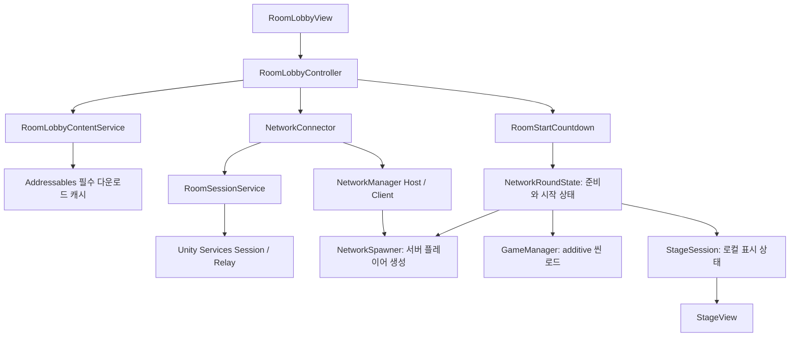
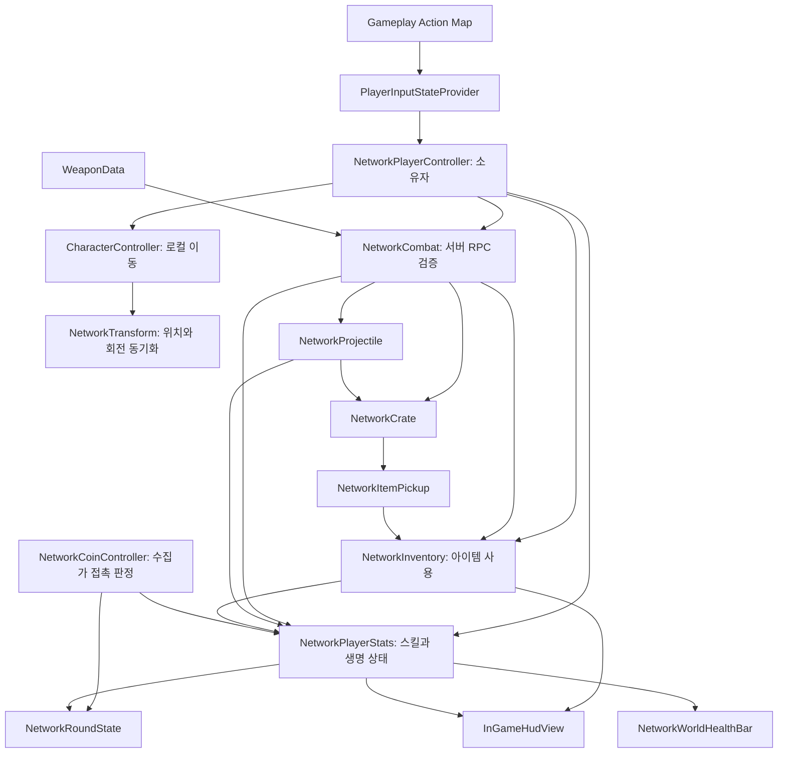

# CoinGame 게임 기획서 (GDD)

> 이 문서는 AI 코딩 에이전트(Codex)가 Unity 프로젝트를 구현할 때 참조하는 기획서입니다.
> - `[확정]` = 기획자가 정한 사양. 임의로 바꾸지 말 것.
> - `[제안]` = 기획 보강안. 구현 시 기본값으로 사용하되, 모든 수치는 ScriptableObject/설정 파일로 분리해 쉽게 조정 가능하게 할 것.
> - `[미정]` = 결정이 필요한 항목. 기본 가정값으로 구현하고 TODO 주석을 남길 것.

---

## 1. 개요

| 항목 | 내용 |
|---|---|
| 게임 제목 | **CoinGame** |
| 장르 | 탑뷰 캐주얼 슈팅 아케이드 `[확정]` |
| 플랫폼 | PC, 모바일 `[확정]` |
| 타깃 유저 | 10대 `[확정]` |
| 아트 방향 | 스타일라이즈 카툰풍 `[확정]` |
| 엔진 / 파이프라인 | Unity 6.7f1, URP `[확정]` |

### 한 줄 소개 `[확정]`
코인 수집가는 스테이지마다 남은 코인을 모두 먹으며 마지막 스테이지까지 살아남으면 승리하고, 코인 방해자는 수집가를 방해하며 전원을 처치하면 승리하는 비대칭 대전 게임.

### 핵심 재미 요소 `[확정]`
- 초반에는 코인 방해자에게 쫓기기만 하지만, 스테이지를 통과할 때마다 아이템으로 강해져 상황을 뒤집는 **역전의 재미**.

### 디자인 필러 `[제안]`
1. **쫓기다가 사냥하는 쾌감**: 수집가의 성장 곡선이 가장 큰 재미. 초반은 도망/생존, 후반은 반격 가능.
2. **짧고 직관적인 라운드**: 10대 유저 대상, 한 판 5~8분 내외.
3. **긴장과 코미디의 균형**: 폭력 표현은 코믹하고 가볍게(피 표현 없음, 쓰러지면 "기절" 연출 등).
4. **한 판 안에서 계속 오는 선택**: 어떤 상자를 깰지, 어떤 아이템을 쓸지, 코인을 먼저 먹을지 도망칠지.

---

## 2. 역할 및 승패 조건

### 2.1 역할 `[확정]`
| 역할 | 목표 | 승리 조건 | 패배 조건 |
|---|---|---|---|
| 코인 수집가 (Collector) | 스테이지마다 남은 코인을 전부 수집 | 마지막 스테이지까지 **1명이라도 생존** | 수집가 **전원 사망** |
| 코인 방해자 (Disruptor) | 수집가 방해 및 처치 | 마지막 스테이지까지 **수집가 전원 처치** | 마지막 스테이지 종료 시 수집가가 1명이라도 생존 |

### 2.2 승패 처리 세부 규칙 `[제안]`
- **스테이지 클리어**: 해당 스테이지의 코인을 모두 수집하면 클리어. 생존 중인 수집가가 있어야 다음 스테이지로 진행.
- **스테이지 제한 시간**: 스테이지마다 제한 시간 존재(기본 90초, 설정 가능). 시간 초과 시 **미수집 코인 수만큼 전체 수집가 체력 페널티** 후 다음 스테이지로 진행 (바로 패배 처리하지 않음. 쫓기기만 하는 초반의 답답함 방지).
  - `[미정]` 시간 초과 시 처리 방식. 기본값은 위 페널티 방식.
- **마지막 스테이지 종료 판정**: 마지막 스테이지를 클리어(또는 시간 종료)했을 때 수집가가 1명이라도 살아 있으면 수집가 승리.
- **방해자 조기 승리**: 도중에 수집가 전원이 사망하면 즉시 방해자 승리.
- **방해자 사망 처리**: 방해자도 체력이 있으며, 수집가의 무기에 맞으면 체력이 깎임. 사망 시 일정 시간(기본 5초) 후 안전 지점에서 리스폰. (방해자는 영구 사망 없음, 수집가만 영구 사망 `[제안]`)
- **수집가 사망**: 부활 아이템이 있으면 부활, 없으면 영구 사망. 사망 후 관전 모드로 전환(살아있는 팀원 시점 따라보기).

### 2.3 부활 규칙 `[확정 + 제안]`
- 부활 아이템 사용 키 `5` `[확정]`, 최대 1개 보유 `[확정]`, 낮은 확률 드롭 `[확정]`.
- `[제안]` 사망 시 **자동 부활이 아니라 사망 후 3초 이내에 수동 사용**. 아이템 보유 중 사망하면 "부활!" 버튼 프롬프트를 띄우고 3초 안에 누르면 제자리 부활(체력 50%), 안 누르면 영구 사망. 모바일에서도 같은 UI 사용.
  - `[미정]` 자동 부활 vs 수동 부활. 기본값은 수동 3초.

---

## 3. 게임 모드 및 설정

### 3.1 설정 항목 `[확정]`
| 설정 | 기본값 | 비고 |
|---|---|---|
| 스테이지(라운드) 수 | 5 | 사용자 변경 가능 (권장 범위 3~10) `[제안]` |
| 플레이어 수 | 2 | 사용자 변경 가능 (권장 범위 2~8) `[제안]` |
| 역할 선택 | 수집가 / 방해자 | 아래 배정 규칙 적용 |

### 3.2 역할 배정 규칙 `[확정]`
- 플레이어 수의 비율에 맞춰 **최대한 반반**으로 맞춘다.
- 한쪽 정원이 꽉 차 있으면 **자동으로 다른 쪽 역할**로 배정.

정원 계산 `[제안]`:
```
방해자 정원  = floor(playerCount / 2)    // 최소 1
수집가 정원  = playerCount - 방해자 정원   // 홀수면 수집가가 1명 더 많음
```
- 예: 2명 → 수집가 1 / 방해자 1, 3명 → 수집가 2 / 방해자 1, 4명 → 2 / 2.
- 모든 플레이어가 같은 역할을 원하면 선택 순서(먼저 선택한 사람 우선)로 정원까지만 배정, 나머지는 자동 배정.

### 3.3 플레이 방식 [확정]
- 네트워크 구조는 기존 프로젝트(PlatformCoinLab)에 이미 구현되어 있다.
- 새 기능은 기존 네트워크 구조를 그대로 사용해서 구현한다. 네트워크 코드를 새로 만들거나 교체하지 말 것.
- 게임 로직(판정, 상태 변경)은 기존 구조의 권한 방식(호스트/서버)에 맞춰 구현한다.
- 봇은 테스트와 밸런스 시뮬레이션용으로만 사용한다.

---

## 4. 게임 흐름

### 4.1 전체 플로우 `[제안]`
```
타이틀 → 설정(스테이지 수, 인원, 역할) → 로딩
   → [스테이지 N 시작 카운트다운 3초]
   → 스테이지 플레이 (코인 수집 / 방해 / 전투)
   → 스테이지 종료 판정
        ├ 수집가 전원 사망 → 방해자 승리 → 결과 화면
        ├ 마지막 스테이지 종료 & 수집가 생존 → 수집가 승리 → 결과 화면
        └ 그 외 → 스테이지 간 정비 화면(체력 회복·성장) → 스테이지 N+1
```

### 4.2 코어 루프 `[제안]`
- **수집가**: 코인 위치 파악 → 방해자 회피 → 상자 부수기/아이템 획득 → 코인 수집 → 스테이지 클리어 → 강화.
- **방해자**: 수집가 추적 → 밀치기/스킬 사용 → 무기로 공격 → 코인 수집 방해.

### 4.3 스테이지 간 정비 `[확정 + 제안]`
- 다음 스테이지로 넘어갈 때마다 **모든 플레이어 체력 일정량 즉시 회복** `[확정]`, **기본 체력량 증가** `[확정]`.
- `[제안]` 수치 (설정 가능):
  - 기본 최대 체력: 시작 100, 스테이지 클리어마다 +20.
  - 회복량: 최대 체력의 40%.
  - 이 보너스는 **수집가/방해자 모두 동일 적용**(규칙 확정 사항). 단, 밸런스는 방해자의 공격 성능·쿨타임·코인 접근 제한으로 조정.

### 4.3.1 스테이지 간 선택 보상 `[제안]`
정비 화면에서 수집가에게만 **3개 중 1개를 고르는 강화 카드**를 제공해 "역전의 재미"를 강화한다. 방해자에게도 별도 카드(스킬 쿨타임 감소 등)를 준다.

| 구분 | 카드 예시 |
|---|---|
| 수집가 | 이동속도 +8%, 탄창 +20%, 코인 자석 범위 +30%, 무기 공격력 +10%, 시작 시 일시 무적 1회 |
| 방해자 | 밀치기 거리 +15%, 스킬 쿨타임 -1초, 이동속도 +5%, 추적 레이더 지속시간 증가 |

- 이 카드는 **선택 연출이 되는 핵심 성장 포인트**이므로 UI 구현 시 `ScriptableObject` 기반 카드 데이터로 만들 것.

### 4.4 스테이지 전환 연출 [확정 + 제안]
- 스테이지를 통과하면 화면이 자동으로 위쪽으로 스크롤되며 다음 맵으로 이동한다. [확정]
- 다음 맵에 도착하는 순간, 플레이어들이 걸어 들어오면서 나타난다. [확정]
- [제안] 전환 순서:
  1. 클리어 연출 (폭죽, 체력 회복 표시)
  2. 정비 단계 (체력 회복, 최대 체력 증가, 강화 카드 선택)
  3. 카메라가 위로 스크롤 (현재 맵 위쪽에 다음 맵이 이어져 보임)
  4. 플레이어가 자동으로 위쪽으로 걸어서 다음 맵 시작 지점에 입장
  5. 입장 완료 후 카운트다운 3초, 입력 해제, 스테이지 시작
- [제안] 전환 중에는 입력 잠금, 모든 플레이어 무적, 방해자 스킬 사용 불가.
- [제안] 사망한 수집가는 관전 상태를 유지하고 전환 연출에는 참여하지 않는다.
- [제안] 전환 연출은 서버가 시작 시점과 종료 시점만 동기화하고, 스크롤과 걷기는 각 클라이언트가 같은 타이밍으로 연출한다.

---

## 5. 조작 방법

### 5.1 PC 조작 `[확정]`

**코인 수집가**
| 동작 | 키 |
|---|---|
| 이동 | W / A / S / D |
| 상호작용 | P |
| 무기 선택 및 상태 | `1` Fist / `2` Gun / `3` Sword |
| 무기 공격 및 상자 부수기 | K |
| 장전 | R |
| 이동 부스트 아이템 사용 | 4 |
| 부활 아이템 사용 | 5 |

**코인 방해자** (수집가 조작 + 아래 추가)
| 동작 | 키 | 비고 |
|---|---|---|
| 수집가 밀치기 (기본 방해) | O | `[제안]` 쿨타임 3초 |
| 수집가 아이템 일시 습득 불가 (기본 스킬) | L | **쿨타임 10초** `[확정]` |

> 이동은 WASD, 조준은 이동 방향 기반 `[제안]`. 아래 5.3 참고.

### 5.2 모바일 조작 `[제안]`
- **왼쪽 하단**: 가상 조이스틱 (이동).
- **오른쪽 하단**: 큰 공격 버튼(K), 그 주변에 작은 버튼 배치.

| 동작 | 모바일 UI |
|---|---|
| 이동 | 왼쪽 가상 조이스틱 |
| 공격 / 상자 부수기 | 우측 하단 큰 버튼 |
| 장전 | 공격 버튼 위 작은 버튼 |
| 무기 선택 (1/2/3) | Fist/Gun/Sword 아이콘 버튼 |
| 상호작용 | 상호작용 가능 대상 근처에서만 나타나는 버튼 |
| 이동 부스트 (4) | 우측 퀵슬롯 4 |
| 부활 (5) | 우측 퀵슬롯 5 (사망 시 3초 팝업으로도 표시) |
| 밀치기 (O, 방해자) | 공격 버튼 좌측 버튼 |
| 아이템 방해 스킬 (L, 방해자) | 버튼 + 쿨타임 원형 게이지 |

- 모든 버튼 크기·위치는 설정에서 조절 가능하게 할 것 (HUD 레이아웃 저장).
- 노치/세이프에어리어 대응.

### 5.3 조준 및 공격 방식 `[제안]`
- 탑뷰이므로 **캐릭터의 마지막 이동 방향이 바라보는 방향**. 정지 시에도 마지막 방향 유지.
- PC에서 마우스 조준은 사용하지 않는다(키보드 전용 확정 조작 유지).
- 모바일은 공격 버튼을 누른 채 방향 드래그하면 에임 보조선이 표시되는 선택 기능을 후순위로 둔다.
- 총: 직선 투사체(탄환). 검: 전방 부채꼴 근접 공격, 투사체 방어 불가, 쿨타임 짧음.

### 5.4 입력 시스템 구현 지침
- Unity **Input System 패키지** 사용, Action Map: `Gameplay`, `UI`.
- 플랫폼 무관하게 `PlayerInputState` 구조체(이동 벡터, 공격, 장전 등)로 추상화해서 PC/모바일/봇이 같은 인터페이스를 쓰게 할 것.

---

## 6. 아이템 시스템

### 6.1 아이템 분류 `[확정]`
- **소유형(인벤토리에 보관, 플레이어가 직접 컨트롤)**: 무기, 탄약, 이동 부스트, 부활
- **즉시 사용형(획득 즉시 효과 적용)**: 체력 회복, 일시 무적, 은신
- **랜덤 아이템**: 위 아이템 중 하나가 랜덤으로 지급됨

### 6.2 아이템 상세

| 아이템 | 유형 | 효과 | 보유 제한 | 수치 `[제안]` |
|---|---|---|---|---|
| Fist | 기본 무기 | 기본 근접 공격 및 상자 공격 | 항상 보유 | `1` 상태, 수집가/방해자별 플레이어 피해 적용 |
| 총 | 소유형 | 투사체 원거리 공격 | 선택 획득 | `2` 상태, 데미지 12, 탄창 12발, 발사 간격 0.3초 |
| 검 | 소유형 | 근접 부채꼴 공격, 상자 파괴 빠름 | 선택 획득 | `3` 상태, 데미지 20, 공격 간격 0.6초, 사거리 1.5m |
| 탄약 | 소유형 | 총 예비 탄약 충전 | 예비 탄약 최대 60 | 획득 시 +24 |
| 체력 회복 | 즉시 | 체력 회복 | - | 최대 체력의 30% |
| 이동 부스트 | 소유형 | 사용 시 이동속도 증가 | **최대 1개** `[확정]` | 지속 3초, 속도 +50% |
| 일시 무적 | 즉시 | 일정 시간 피해 무시 | - | 지속 4초 |
| 은신 | 즉시 | 상대에게 안 보임 | - | 지속 5초, 공격 시 해제 |
| 부활 | 소유형 | 사망 시 부활 | **최대 1개** `[확정]`, **낮은 확률** `[확정]` | 체력 50%로 부활, 부활 후 2초 무적 |
| 랜덤 | 즉시 | 위 아이템 중 하나 랜덤 지급 | - | 가중치 테이블 참고 |

- **무기 상태** `[확정]`: `None` 상태는 사용하지 않는다. 모든 플레이어는 Fist를 항상 보유하고 `1`로 선택한다. Gun과 Sword를 획득하면 각각 `2`, `3`으로 선택할 수 있다. 미보유 무기를 선택하면 현재 Fist 상태를 유지한다.
- **라운드 무기 갱신** `[제안]`: 보유한 Gun/Sword는 다음 라운드 시작 시 해당 타입의 다른 `WeaponData` 변형으로 갱신하고, 탄창과 예비 탄약은 선택된 변형의 기본값으로 되돌린다. 변형이 하나뿐이면 같은 데이터를 재사용한다.
- **소유 중 추가 획득 시** (이동 부스트, 부활): 습득되지 않고 상자/바닥에 그대로 남는다 `[확정]`.
- **은신 `[제안]`**: 상대 시점에서는 반투명이 아니라 완전 비표시. 단, 아군에게는 반투명. 은신 중 코인 수집은 가능, 공격하거나 피격 시 해제.

### 6.3 드롭 확률 `[제안]`
가중치 합이 100 기준이며 설정으로 조정 가능.

| 아이템 | 가중치 |
|---|---|
| 탄약 | 22 |
| 체력 회복 | 20 |
| 총 | 10 |
| 검 | 10 |
| 이동 부스트 | 12 |
| 일시 무적 | 8 |
| 은신 | 8 |
| 랜덤 | 7 |
| 부활 | 3 |

- 이미 보유 제한에 걸린 아이템(부스트/부활)은 드롭 테이블에서 제외하고 재추첨.
- 랜덤 아이템이 부활을 뽑을 확률은 낮게(일반 가중치 그대로 적용) 하되, 보유 제한 시 재추첨.
- **구도 보정** `[제안]`: 스테이지가 올라갈수록 총/무기/무적 가중치 상승, 수집가가 초반에 몰리지 않게 **코인 근처에 아이템 상자 배치**.

### 6.4 아이템 획득 방식 `[제안]`
- **상자(Crate)**: 수집가와 방해자 모두 기본 공격(K)으로 부숴서 아이템을 얻는다. 수집가는 기본 주먹으로 시작하고, 방해자는 더 높은 플레이어 공격력을 사용한다. 상자에 적용되는 피해량은 역할과 관계없이 무기별 `CrateDamage`를 사용한다. 총과 검도 상자를 공격할 수 있다.
- **바닥 아이템**: 일부는 맵에 고정 스폰.
- **상호작용(P)**: 고정 보급 상자, 문, 상점 같은 특수 오브젝트와 상호작용. (아이템 줍기는 접촉 자동 획득, 단 무기는 P로 교체 `[제안]`)
- **방해자 스킬 `L` (아이템 일시 습득 불가 디버프)**: 수집가 전원 또는 시야 내 수집가에게 **5초간** 아이템 습득 불가를 건다. `[제안]` 지속 5초, 쿨타임 10초 `[확정]`. 코인 수집은 막지 않는다. 적용 대상 수집가 머리 위에 🚫 아이콘 표시.

#### 파트 1 확정 보완 `[확정]`
- 상자는 `Closed → Opened → Destroyed` 상태를 서버 `NetworkVariable`로 동기화한다.
- HP가 0이 되면 `Opened`로 전환하고 서버에서 아이템을 정확히 1회 드롭한다. 드롭 위치는 `CrateData.DropOffset`의 상자 기준 월드 단위 오프셋을 사용하며, 기본값은 상자 위쪽과 앞쪽으로 띄워 플레이어와 겹치지 않게 한다. 아이템은 상자 파괴 전까지 Trigger를 비활성화하고, 추가 타격으로 `Destroyed`가 된 뒤 습득 가능하게 한다.
- 열린 상자는 추가 타격 1회 후 `Destroyed`로 전환하고 Despawn한다.
- 뚜껑은 `CrateData`의 회전축·각도·시간으로 코드 보간하고 Animator는 사용하지 않는다.

---

### 상자 스폰 배치 설정 (2026-11-17 구현)

- `Coin_Spawner`와 `Crate_Spawner`는 같은 `NetworkSpawner`를 사용한다. `Spawn Kind`로 Coin/Crate를 구분하고, 상자 개수는 기존 StageConfig를 유지한다. 상자 풀링과 반복 리스폰은 사용하지 않는다.
- `ScriptableObject/Spawn/CrateRotation.asset`의 `_minVector`/`_maxVector`는 Euler 각도 범위다. 기본 Min=(0,0,0), Max=(0,360,0)으로 Y축만 무작위 회전한다. 기존 VectorMinMaxData를 재사용한다.
- `CratePlacement.asset`에서 LocalForward(+Z), BlockingMask(Default/Environment/Grass), RotationAttempts(16), FrontDistance(1.2m), FrontHalfWidth(0.4m), FrontHalfHeight(0.3m), CollisionPadding(0.02m)을 Inspector로 조정한다. 각 설정은 서버 배치에 적용한다.
- 회전한 BoxCollider가 겹치는 후보를 제외하고, 전면 BoxCast로 접근 공간이 열린 방향을 선택한다. 전면이 모든 후보에서 막힌 경우에는 겹침 없는 후보 중 여유가 가장 큰 방향을 사용하고 경고한다. 겹침 없는 후보 자체가 없으면 생성 실패를 기록하고 예약을 남기지 않는다.
- CoinPlacement는 기존 위치 보정과 프리팹 회전을 유지한다. 풀 객체도 Spawn 전에 위치·회전을 다시 적용한다. 두 종류 모두 전체 Ground Grid를 사용하며 전용 Zone을 만들지 않는다.
- 기존 BaseSpawner/NetworkSpawner는 직렬화 및 플레이어 생성 수명주기를 보존하기 위해 길이 규칙의 예외로 유지하고, 새 배치 판정·설정·배치 정리 책임은 별도 코드로 분리했다.
- 통합 후 남은 미사용 `NetworkCrateSpawner.cs`와 `.meta`를 제거했다. 이전 예약 API 호출로 발생한 CS0117 두 건을 해결했으며, 씬·프리팹 GUID 참조가 없음을 확인했다. Unity 6000.6.7f1 재컴파일 성공 및 Console 오류·경고 0개를 확인했다. 이번 정리는 컴파일 검증만 수행했다.

## 7. 전투 시스템

### 7.1 공통 `[제안]`
- 투사체: 오브젝트 풀링, 속도 14m/s, 사거리 12m.
- 피격 시 짧은 경직(0.1초)을 적용한다. 무기 피해에는 별도 피격 무적 시간을 적용하지 않고 공격 간격으로 연속 피해를 제어한다. 아이템 무적과 비무기 피해의 보호 시간은 상태 설정을 따른다.
- 모든 데미지는 `DamageInfo { attacker, amount, type, knockback }` 구조로 처리.

### 7.2 밀치기 (방해자 기본 방해) `[확정 + 제안]`
- 수집가를 앞 방향으로 밀친다. `RoleAbilityConfig.AbilityRange` 안에서만 적용하며 기본 거리는 2.5m, 짧은 스턴 0.4초, 쿨타임 3초다.
- 맵의 **함정/장애물/구덩이 방향으로 밀면 추가 피해** (맵 활용 재미).
- 코인을 들고 있는 개념은 없으므로 밀치기로 직접 코인을 빼앗지는 않고, **코인 수집 방해(경로 이탈)** 와 **체력 피해** 용도.

### 7.3 피해 및 체력
- 방해자는 **총/검 둘 다 사용 가능**(조작 키가 동일 `[확정]`).
- 수집가도 총/검을 얻어 방해자를 공격할 수 있다 (역전 재미의 핵심).
- 최대 체력 시작 100 + 스테이지당 20 `[제안]`.
- 팀킬 없음.

---

## 8. 코인 및 스테이지

### 8.1 코인 `[제안]`
- 스테이지마다 맵에 코인이 일정 수 배치되며, 접촉하면 수집. 수집가만 수집 가능, 방해자는 불가.
- **코인 수 증가**: 스테이지 N 코인 수 = `baseCoin + (N-1) * step` (기본 10, +3).
- 코인 배치: 한 곳에 몰리지 않게 구역(Zone)별 최소/최대 개수 지정.
- 일부 코인은 **상자 안/위험 지역**에 숨겨져 있음(전부 수집 조건이라 필수 경로 설계).
- **다중 수집가**: 코인은 **팀 공동 수집**. 모든 코인을 합산해서 달성하면 클리어.
- 수집한 코인은 팀 진행도 바에 표시: "코인 7/13".

#### 파트 1 확정 보완 `[확정]`
- `CoinZones`와 `CrateZones`는 생성하지 않는다. Grid Spawn 경로의 `Coin_Spawner`와 `Crate_Spawner` 후보 범위는 전체 `Ground` 셀이다.
- 후보 셀은 `Ground`이면서 `StaticBlocked`가 아니어야 하고, 서버의 공용 예약으로 플레이어·코인·상자 간 중복을 막는다.
- Grid 자산이 없는 legacy 경로에서만 기존 Zone 탐색, 장애물 겹침, Ground 레이캐스트, 최소 거리 검사를 사용한다.

### 8.2 스테이지 설계 `[제안]`
스테이지는 `StageMapPool`에 등록된 여러 맵 프리팹에서 서버가 랜덤 선택한다. 직전 라운드 맵과 다른 맵을 우선 선택하고, 등록 맵이 하나뿐이면 같은 맵을 허용한다.

| 스테이지 | 콘셉트 | 방해자 난도 | 특징 |
|---|---|---|---|
| 1 | 연습장 | 낮음 | 넓은 맵, 엄폐물 많음, 코인 적음 |
| 2 | 미로 정원 | 중간 | 좁은 통로, 코너 많음 |
| 3 | 폐공장 | 중간 | 컨베이어 벨트(이동 방해), 폭발 상자 |
| 4 | 얼음 광장 | 높음 | 미끄러운 바닥, 이동 제어 어려움 |
| 5 | 보스 아레나 | 높음 | 코인 많음, 중앙 고급 보급 상자, 시야 제한 |

- 스테이지 수가 설정값과 다를 때: 등록된 맵 풀을 반복 사용하되 직전 라운드와 같은 맵은 가능한 한 피한다 `[제안]`.
- 장애물: 가시 함정, 이동 플랫폼, 폭탄 상자 같은 환경 요소(최소 3종 이상) `[제안]`.

#### 파트 1 확정/제안 보완
- Palmov Island `Location with environment`는 원본을 수정하지 않고 `_CoinGame/Prefabs/Maps`의 복사본에서 사용한다. `[확정]`
- 맵 프리팹 표준 자식은 `StartAnchor`, `ExitAnchor`, `PlayerSpawnPoints`, `Bounds`, `Decor`, `Ground`이다. `[확정]`
- 맵 높이 pitch는 고정하고 하단·상단 앵커를 같은 X/Z 정렬 규칙으로 배치한다. `[확정]`
- `Map_Palmov_A/B/C` 변형은 같은 에셋의 배치 차이로 순환한다. `[제안]`

### 8.3 난이도 곡선 (역전 구조) `[제안]`
```
스테이지 1-2: 수집가가 약하고 방해자 우세 (수집가는 도망·회피 중심)
스테이지 3  : 수집가가 무기/부스트 확보, 균형
스테이지 4-5: 수집가 강화 카드 누적, 수집가 역공 가능
```
- 수집가 승률 목표 45~55%, 5라운드 기준 평균 플레이 시간 6~8분. 수치는 밸런스 테스트 후 조정.

---

## 9. 추가 재미 요소 제안 `[제안]`

우선순위가 있고, 구현이 가볍고 재미를 주는 순서로 정리.

1. **코인 자석 / 콤보**: 짧은 시간 내 연속 코인 수집 시 콤보 연출과 이펙트(10대 타깃, 쾌감).
2. **방해자 레이더**: 일정 주기(20초)마다 가장 가까운 수집가 방향을 화살표로 표시.
3. **수집가 팀 시너지**: 두 수집가가 가까이 있으면 이동속도 +5% (뭉치는 선택 vs 흩어지는 선택).
4. **이모트/핑**: 모바일 대응 간단 이모트 4종(도와줘, 여기, 조심, 굿).
5. **결과 화면 MVP/칭호**: "코인 사냥꾼", "도망의 달인", "밀치기 장인" 등 재미 칭호.
6. **스테이지 이벤트**: 스테이지 중간 랜덤 이벤트(코인 비, 조명 꺼짐, 폭탄 비). 라운드 후반 한 번.
7. **역전 보정(Catch-up)**: 수집가가 모두 약해졌을 때 부활/체력 드롭 확률 소폭 상승.
8. **스킨/코스메틱**: 수익화가 아닌 일단 `ScriptableObject` 기반 외형 교체 구조만 준비.

---

## 10. UI / UX `[제안]`

### 10.1 화면 목록
- 타이틀, 설정(스테이지/인원/역할), 로비/역할 배정, 로딩, 인게임 HUD, 스테이지 정비(카드 선택), 결과, 옵션(사운드/조작/그래픽).

### 10.2 인게임 HUD
- 상단: 스테이지 번호, 제한 시간, 코인 진행도 `n/m`.
- 좌상단: 내 체력 바, 팀원 체력 소형 표시.
- 우하단: 무기 아이콘+탄약, 퀵슬롯(부스트/부활), 스킬 쿨타임(방해자).
- 상태 아이콘: 무적, 은신, 아이템 습득 불가 디버프.
- 사망 시: 관전 모드 + "부활" 3초 팝업.

### 10.3 피드백 연출 (카툰풍)
- 코인 수집: 반짝 + 짧은 사운드 + 숫자 팝업.
- 피격: 화면 가장자리 빨간 비네트(짧게), 캐릭터 깜빡임.
- 스테이지 클리어: 컬러풀 폭죽 + 체력 회복 연출.

---

## 11. 아트 / 사운드 방향

### 11.1 아트 `[확정 + 제안]`
- **스타일라이즈 카툰풍** `[확정]`.
- 셰이더 `[제안]`: URP Lit 기반 커스텀 Toon 셰이더 또는 Shader Graph. 3단 밴딩 + 림라이트 + 외곽선(Inverted Hull 또는 Renderer Feature). 모바일 성능을 고려해 **외곽선은 옵션**.
- 컬러: 수집가 팀 **밝은 파랑/노랑 계열**, 방해자 팀 **자주/빨강 계열**로 팀 식별이 한눈에 되게.
- 코인은 **고채도 금색 + 발광(Emission)**으로 시선을 끌 것.
- 카메라: 탑뷰 약간 비스듬한 각도(60°~70°), 플레이어를 따라가지 않는 고정 카메라. `[확정]`
- 캐릭터는 Yurowm Humanoid 캐릭터 기반으로 사용하고 수집가는 밝은 파랑/노랑, 방해자는 자주/빨강 계열 틴트로 구분한다. `[확정]`

### 11.2 사운드 `[확정: 방향 일정 / 제안]`
- **방향 일정**(나중에 정함) `[미정]`. 임시로 무료 에셋/플레이스홀더 사용 가능하도록 `AudioManager`와 `SoundData` 구조만 만들 것.
- 사운드 이벤트 목록: 코인 수집, 총 발사, 장전, 검 휘두름, 피격, 밀치기, 아이템 획득, 부활, 스테이지 클리어, 승리/패배, UI 클릭.
- BGM: 스테이지 진행 따라 템포 상승(1~5), 마지막 스테이지는 긴박한 편곡.

---

## 12. 기술 설계 (Unity 구현 지침)

### 12.1 환경
- **Unity 6.7f1**, **URP**.
- 사용 패키지: Input System, Cinemachine(카메라), TextMeshPro, Addressables(선택), Netcode for GameObjects(`[미정]`, 후순위).
- 코드 언어: C#, 네임스페이스 `CoinGame.*`.

### 12.2 폴더 구조

2026-11-11 현재 작업 폴더를 기준으로 정리했다. Git에 아직 반영되지 않은 에셋 이동도 포함한다. 아래는 **현재 구현의 위치**이며, 기획에만 있는 클래스를 생성하라는 의미가 아니다.

#### 프로젝트 루트

```text
PlatformCoinLab/
  Assets/                # 게임 코드, 씬, 설정, 외부 에셋
  Packages/              # manifest.json, packages-lock.json, 패키지 구성
  ProjectSettings/       # Unity 버전·입력·빌드 등 프로젝트 설정
  ServerData/            # Addressables Windows 번들·카탈로그 빌드 산출물
  Data/                  # 현재 Plugins/lib_burst_generated.* 산출물
  agents/                # 역할별 TOML 지침(manifest)
  .codex/                # 프로젝트 안내와 Unity MCP 호출용 도구
  AGENTS.md              # 공통 작업 규칙
  CoinGame_GDD.md         # 게임 기획서와 현재 코드 안내
  M2_PROGRESS.md         # M2 작업 기록
```

파트 1 추가 경로: `Assets/_CoinGame/Prefabs/Maps/`, `Assets/_CoinGame/Prefabs/Characters/`, `Assets/_CoinGame/Scripts/Editor/`, `Assets/_CoinGame/Scripts/Gameplay/Items/CrateData.cs`, `Assets/_CoinGame/Scripts/Network/NetworkPlayerAnimator.cs`.

`Library/`, `Temp/`, `Logs/`, `UserSettings/`와 자동 생성 `.csproj`/`.slnx`는 캐시·개인 설정·IDE 산출물이다. 게임 소스 위치로 사용하지 않는다.

#### 게임 소유 에셋과 스크립트

```text
Assets/
  _CoinGame/                         # 현재 게임 구현의 중심
    CoinGame_Actions.inputactions    # Gameplay, UI Action Map
    Animation/                       # Animator, 애니메이션, Timeline, Signal
    Material/                        # 플레이어·지면·코인·Shield 머티리얼
    Materials/                       # 현재 M_Projectile.mat (Material과 별도 폴더)
    Shader/                          # ShieldTriangles.shader
    Scenes/
      Persistent_CoinGameScene.unity # 네트워크 연결·로비·공통 관리자
      InGame_CoinGameScene.unity     # 게임 환경·스포너·인게임 UI
    Prefabs/
      Player.prefab
      NetworkRoundState.prefab
      Coin.prefab
      Coin_Spawner.prefab
      Items/                         # Crate.prefab
      M3/                            # 아이템 외형·픽업·투사체·장착 무기 외형
    ScriptableObject/                # 런타임 설정·아이템·플레이어·세션 데이터
      ItemData/                      # Item_*.asset, Weapon_*.asset, Crate_Default.asset
      Player/                        # AnimatorParameterSet, PlayerStats 관련 데이터
      Session/                       # MultiplayerSession, SessionConnector
      Spawn/                         # CrateRotation(VectorMinMaxData), CratePlacement, CoinPlacement
    Scripts/
      ItemData/                      # 현재 Item_*.asset, Weapon_*.asset 데이터 에셋
      Managers/                      # GameManager
      Sessions/                      # StageSession: 로컬 라운드 상태와 이벤트
      Stage/                         # StageConfig, RoleAbilityConfig 정의
      Player/                        # PlayerAccount, PlayerRole
      Input/                         # PlayerInputState와 입력 공급자
      Gameplay/
        Combat/                      # 무기 데이터·기반 타입·피해 정보
        Items/                       # ItemData 정의
        Player/                      # PlayerStatsConfig, PlayerLifeState
        Stage/                       # 순수 C# 승패 판정
        M1/                          # 보존된 로컬 프로토타입
        M2PrototypeBootstrap.cs      # InGame 단독 실행 시 Persistent 보완 로드
      Network/                       # 연결·로비·서버 판정·상태 동기화·일부 표시
      Timeline/                      # PlayableDirectorController
      UI/                            # 역할 선택·계정·진행도·HUD·승패 결과
      Utilities/                     # 풀·스포너·저장·씬 참조·벡터 유틸리티
      StageLoader.cs                 # Addressables 프리팹 로드와 해제
    Tests/
      EditMode/                      # RoundOutcomeEvaluatorTests.cs
  _Project/                          # 현재 비어 있음. 기존 GDD의 주 구현 경로가 아님
  AgentVFX/
    Editor/                          # JSON 기반 VFX 생성·검증 도구
      Tests/                         # VFX 파이프라인 테스트
    Specs/                           # ElectricExplosion.json
    Generated/                       # 생성된 ElectricExplosion, ShieldCapsule
```

`ScriptableObject/ItemData`, `ScriptableObject/Player`, `ScriptableObject/Session`은 C# 정의가 아닌 **ScriptableObject 인스턴스 에셋**을 담는다. 정의 클래스는 `Gameplay/Combat/WeaponData.cs`, `Gameplay/Items/ItemData.cs` 등에 있다.

#### 공용 설정과 외부 에셋

| 위치 | 현재 용도 |
|---|---|
| `Assets/AddressableAssetsData/` | Addressables 설정, 프로파일, Local_Core/Remote_Required 등 그룹·스키마 |
| `Assets/Settings/` | PC/Mobile URP Asset·Renderer, Volume, Build Profiles |
| `Assets/StreamingAssets/` | 현재 비어 있는 스트리밍 에셋 위치 |
| `Assets/Plugins/`, `Assets/TextMesh Pro/` | 플러그인 및 TMP 리소스 |
| `Assets/2D Casual UI/`, `Assets/3D Assets/`, `Assets/BTM_Assets/`, `Assets/Low Poly Guns/`, `Assets/Palmov Island/`, `Assets/Toon Shaders Pro/`, `Assets/Yurowm/` | 외부 UI·모델·아이템·셰이더·데모 에셋. 게임 코드와 구분 |
| `Assets/Screenshots/`, `Assets/TutorialInfo/`, `Assets/_Recovery/` | 캡처·튜토리얼·복구 씬 |

`ServerData`는 콘텐츠 빌드 결과이며 백엔드 서버 소스 폴더가 아니다. 이 작업 폴더에는 별도 ContentServer 서버 구현이 없고, 연결 상태를 확인하는 클라이언트 코드가 있다.

### 12.3 현재 스크립트의 역할과 연결

아래 경로는 별도 표시가 없으면 `Assets/_CoinGame/Scripts/` 기준이다. 폴더별 책임을 설명하되 실제 파일 배치를 유지했다. 특히 `Network`에는 UI 표시 코드도 있고, `Utilities`에는 네트워크 스포너도 있다.

#### 연결과 로비: Network/

| 스크립트 | 핵심 역할 |
|---|---|
| `NetworkConnector.cs` | NGO 연결/해제 콜백과 호스트/클라이언트 시작, 플레이어 생성·재배치 요청을 중계한다. |
| `RoomSessionService.cs` | Unity Services 초기화·익명 인증, Multiplayer Session 생성·코드 참가·퇴장과 Relay 옵션을 처리한다. |
| `RoomSettings.cs` | 방 ID·이름·인원·역할 정원·라운드·코인 배율 등 방 설정을 표현한다. |
| `RoomSettingsValidator.cs` | 방 설정의 범위·역할 정원 조합을 검증·보정한다. |
| `RoomLobbyController.cs` | UI 입력, 콘텐츠 확인, 방 생성/참가, 역할·설정 변경과 시작 흐름을 조율한다. |
| `RoomLobbyView.cs` | 로비 입력 필드·버튼·참가 코드·상태 표시 등 화면 요소를 갱신한다. |
| `RoomStartCountdown.cs` | 서버가 공유한 시작 시점의 남은 초를 표시한다. 독립 타이머 시작·취소 API도 보존되어 있다. |
| `RoomLobbyContentService.cs` | 로비 진입 후 Addressables 필수 콘텐츠의 남은 다운로드 용량을 확인한다. |
| `ContentBootstrap.cs` / `RoomLobbyContentService.cs` | 부트스트랩에서 Addressables 카탈로그와 필수 번들을 다운로드하며 로비는 남은 다운로드 용량을 확인한다. 별도 health 요청은 사용하지 않는다. |
| `DevQuickStart.cs` | 개발용 빠른 호스트/클라이언트 시작 경로를 제공한다. |

#### 게임 판정과 동기화: Network/

| 스크립트 | 핵심 역할 |
|---|---|
| `NetworkRoundState.cs` | 서버의 방 설정·준비·씬 로드·배치·라운드·시간·코인·승자를 관리하고 NetworkVariable과 RPC로 공유한다. |
| `NetworkPlayerController.cs` | 소유자 입력을 받아 이동·회전·카메라 추적을 수행하고 전투·아이템·방해 스킬 요청을 전달한다. |
| `NetworkPlayerStats.cs` | 역할·체력·생사·부활과 무적·경직·은신·부스트·습득 금지 등 상태를 서버에서 변경·동기화한다. |
| `NetworkCoinController.cs` | 서버에서 Collector의 접촉·수집 가능 여부를 판정하고 남은 코인을 갱신한다. |
| `NetworkInventory.cs` | 서버 권한 무기 슬롯·현재 무기·탄창·예비 탄약·부스트·부활 보유와 아이템 효과 적용을 처리한다. |
| `NetworkCombat.cs` | 공격·장전·무기 변경 RPC를 검증하고 서버에서 쿨타임·탄약·근접/원거리 공격을 처리한다. 장착 외형도 갱신한다. |
| `NetworkProjectile.cs` | 서버에서 투사체 이동·충돌·피해·사거리 종료와 Despawn을 처리한다. 현재 생성은 Instantiate+Spawn이다. |
| `NetworkCrate.cs` | 서버에서 상자 체력·파괴·가중치 드롭을 판정하고 픽업을 생성한다. |
| `Utilities/NetworkSpawner.cs` | Coin/Crate 종류별 라운드 생성 개수·Ground 배치·서버 Spawn을 처리한다. 기존 NetworkCrateSpawner는 제거했다. |
| `NetworkItemPickup.cs` | 서버에서 접촉·습득 제한을 확인하고 인벤토리에 아이템을 적용한다. 클라이언트에서는 아이템 외형을 구성한다. |
| `NetworkWorldHealthBar.cs` | 월드 체력 바를 생성하고 카메라 방향에 맞춘다. 은신한 적의 체력 바는 숨긴다. |
| `M3DebugTools.cs` | 에디터/Development Build용 F1~F9 아이템 지급 요청과 서버 처리를 제공한다. |

#### 게임 흐름·입력·계정

| 경로 | 핵심 역할 |
|---|---|
| `Managers/GameManager.cs` | StageConfig 로드, additive 씬 전환, 서버 상태→로컬 이벤트 중계와 종료 상태를 조율한다. Camera/EventSystem 중복도 정리한다. |
| `Sessions/StageSession.cs` | 라운드 번호·목표/수집 코인·제한 시간을 담는 로컬 값 타입 스냅샷이다. 네트워크 판정의 원본은 NetworkRoundState다. |
| `StageLoader.cs` | Addressables 주소의 프리팹을 비동기 생성하고 파괴 시 인스턴스·핸들을 해제한다. 라운드 판정 담당은 아니다. |
| `Input/PlayerInputState.cs` | 이동 벡터와 공격·상호작용·장전·아이템·스킬 버튼 상태를 담는 구조체다. |
| `Input/PlayerInputStateProvider.cs` | Gameplay Action Map을 읽어 Current 상태를 공급하며 모바일 입력 설정 진입점도 제공한다. |
| `Player/PlayerAccount.cs` | 로컬 임시 GUID·온라인 여부와 변경 알림, 계정 이름 표시를 관리한다. UGS 인증 담당은 아니다. |
| `Player/PlayerRole.cs` | Collector/Disruptor 역할을 나타내는 enum이다. |
| `Timeline/PlayableDirectorController.cs` | 시작 Timeline 재생과 PlayableAsset 변경, Timeline 이벤트의 씬 로드·호스트 라운드 시작을 연결한다. |

#### 데이터 정의와 순수 규칙

| 경로 | 핵심 역할 |
|---|---|
| `Stage/StageConfig.cs` | 라운드 수·제한 시간·코인 증가량과 요구/생성 코인 수 계산을 제공하는 SO다. |
| `Stage/RoleAbilityConfig.cs` | 밀치기·코인 잠금 등 방해 능력의 거리·효과·쿨타임 설정 SO다. |
| `Gameplay/Player/PlayerStatsConfig.cs` | 기본 체력·성장·회복·피격·부활·부스트 등의 수치 SO다. |
| `Gameplay/Player/PlayerLifeState.cs` | Alive·Dead·Spectating 생명 상태를 구분한다. |
| `Gameplay/Stage/RoundOutcomeEvaluator.cs` | 승패와 시간 초과 피해를 계산하는 순수 C# 규칙이다. 현재 NetworkRoundState의 직접 호출은 없다. |
| `Gameplay/Combat/WeaponData.cs` | 무기 종류·피해·공격 간격·사거리·탄약과 손 장착/총구 보정값 SO다. WeaponKind도 정의한다. |
| `Gameplay/Combat/DamageInfo.cs` | 공격자·피해량·종류·넉백을 전달하는 값 타입과 DamageType을 정의한다. |
| `Gameplay/Combat/WeaponBase.cs` | WeaponData를 보관하는 추상 기반 타입이다. |
| `Gameplay/Combat/Gun.cs` | WeaponBase를 상속하는 총 타입이다. 현재 독립적인 발사 구현은 없다. |
| `Gameplay/Combat/Sword.cs` | WeaponBase를 상속하는 검 타입이다. 현재 독립적인 근접 판정 구현은 없다. |
| `Gameplay/Items/ItemData.cs` | 아이템 종류·가중치·효과량·지속시간·무기 연결·외형/픽업 보정값 SO다. |

현재 공격 실행은 `WeaponBase → Gun/Sword` 인스턴스를 거치지 않고 `NetworkCombat`이 `WeaponData`를 읽어 처리한다. 데이터 정의와 실제 실행 코드를 구분해서 읽어야 한다.

현재 플레이어 애니메이터는 `Assets/_CoinGame/Animation/Player/AC_Player.controller`다. 기존 KayKit Idle/Walk의 `MoveSpeed` BlendTree를 유지하고, 상체 마스크의 Rifle 레이어와 전신 Reactions 레이어를 추가했다. `WeaponType`은 실제 `WeaponKind` 값(Fist=0, Gun=1, Sword=2)을 사용한다. 이동은 각 클라이언트가 위치 변화로 계산하고, 발사·장전은 서버 버전, Hit·Death·복귀는 서버 체력/생명 상태로 재생한다. 라이플에는 조준/반동/장전을 연결하고, Death가 Hit보다 우선한다. 총은 오른손 `RifleSocket/Muzzle`에 연결하고 검은 기존 `WeaponSocket`을 사용한다. 스테이지별 무기 자동 변경은 아직 구현하지 않았다.

### 파트 1 변경 요약
- `CrateData`와 상자 열림/추가 타격 상태를 추가했다.
- Yurowm 캐릭터 복사본과 `AC_YurowmPlayer` 컨트롤러를 `_CoinGame` 아래에 배치했다.
- 기존 Player 루트 네트워크 컴포넌트와 모델 메시를 보존하고 Yurowm 모델을 자식으로 연결했다.
- Palmov 기반 `Map_Palmov_A/B/C`와 앵커·구역·Bounds 표준 구조를 추가했다.
- 코인/상자 후보 위치에 Grid Ground 셀 예약을 추가하고, 맵 생성 도구와 현재 InGame 씬에서 Coin/Crate 전용 Zone을 제거했다.
- `CoinGame/Validate Active Map` 에디터 검증 메뉴를 추가했다.

#### 화면 표시: UI/

| 스크립트 | 핵심 역할 |
|---|---|
| `PlayerAccountView.cs` | 로컬 계정의 UI 표시 이름을 출력한다. |
| `PlayerNamePopup.cs` | Persistent 진입 시 이름을 입력·확인하며 공백 입력을 거부한다. |
| `RoleRosterView.cs` | 각 클라이언트에 스폰된 Player의 역할과 동기화 이름으로 Collector/Disruptor 목록을 갱신한다. |
| `MatchResultView.cs` | 최종 승패에 따라 로컬 역할 기준 `WIN` 또는 `LOSS`를 크게 표시한다. |
| `RoleSelectionUI.cs` | 역할 선택 버튼으로 서버에 변경을 요청하고 정원·선택 상태를 표시한다. |
| `StageView.cs` | 라운드·남은 시간·코인 수집 진행도와 종료 상태를 표시한다. |
| `InGameHudView.cs` | 로컬 플레이어 체력·무기·탄약·퀵슬롯·상태·부활 대기·스킬 쿨타임을 표시한다. |

#### 생성·풀링·공용 도구: Utilities/

| 스크립트 | 핵심 역할 |
|---|---|
| `BaseSpawner.cs` | 생성 영역·위치 등 스포너 공통 기반을 제공한다. |
| `Spawner.cs` | 일반 GameObjectPool을 사용하는 로컬 오브젝트 생성·회수를 담당한다. |
| `NetworkSpawner.cs` | 플레이어 생성·재배치를 유지하며 Coin/Crate 공통 생성에 GridSpawnPlacement, NetworkSpawnBatch를 사용한다. |
| `GridSpawnPlacement.cs` | Ground 후보와 설정된 Vector3 회전 범위에서 배치를 선택하고 상자 몸체 겹침·전면 여유를 검사한다. |
| `NetworkSpawnBatch.cs` | 스포너가 생성한 객체를 추적하고 라운드 변경 시 이전 객체·예약을 정리한다. |
| `SpawnPlacementSettings.cs` | 회전 범위, 위치 보정, 전면 방향·거리·폭과 LayerMask를 담는 설정 SO다. |
| `GameObjectPool.cs` | 일반 GameObject를 재사용하고 반환받는 풀이다. |
| `NetworkGameObjectPool.cs` | NGO 프리팹 핸들러와 네트워크 객체 재사용을 연결하고 Spawn/Despawn 경로를 제공한다. |
| `PlayerPrefsStorage.cs` | PlayerPrefs 기반 저장·조회 유틸리티다. |
| `SceneReference.cs` | 에디터 씬 에셋과 런타임 씬 경로를 연결하는 직렬화 참조다. |
| `VectorMinMaxData.cs` | Vector3 최소·최대 범위를 보관하는 SO로 이동/생성 영역 설정에 사용한다. |
| `VectorExtensions.cs` | 벡터 범위 제한·범위 내 임의 좌표 등 공통 연산을 제공한다. |

#### 프로토타입과 테스트

| 경로 | 핵심 역할 |
|---|---|
| `Gameplay/M1/M1Prototype.cs` | 초기 로컬 이동·코인 생성/수집·라운드/HUD 검증용이다. 네트워크가 동작 중이면 비활성화된다. |
| `Gameplay/M1/M1Coin.cs` | M1 로컬 프로토타입의 코인 접촉과 수집 알림을 처리한다. |
| `Gameplay/M1/M1StageConfig.cs` | M1 전용 이동·코인·시간·라운드 설정 SO다. |
| `Gameplay/M2PrototypeBootstrap.cs` | InGame 단독 실행 시 Persistent 씬을 additive 로드해 기존 실행 기반을 마련한다. |
| `Assets/_CoinGame/Tests/EditMode/RoundOutcomeEvaluatorTests.cs` | 순수 승패 규칙의 수집가 생존/전멸과 마지막 라운드 조건을 검증한다. |

#### VFX 에디터 도구

다음 경로는 `Assets/AgentVFX/Editor/` 기준이며 런타임 전투 판정과 분리되어 있다.

| 스크립트 | 핵심 역할 |
|---|---|
| `AgentVfxModels.cs` | JSON 명세용 VfxSpec·하위 설정과 생성 결과 타입을 정의한다. |
| `VfxSpecJson.cs` | JSON 파싱·입력 검증과 출력 경로용 해시 계산을 수행한다. |
| `AgentVfxPipeline.cs` | 명세를 읽어 텍스처→메시→머티리얼→프리팹 생성과 검증을 순서대로 실행한다. |
| `TextureGenerator.cs` | 시드·노이즈·그라디언트·방사형 알파를 조합한 PNG를 생성한다. |
| `MeshGenerator.cs` | Quad/Ring/Cone 메시 에셋을 생성한다. |
| `MaterialGenerator.cs` | 지정 셰이더와 생성 텍스처·색을 연결한 머티리얼을 만든다. |
| `ParticleSystemBuilder.cs` | 명세의 수명·속도·크기·버스트·시뮬레이션 설정을 ParticleSystem에 적용한다. |
| `VFXPrefabBuilder.cs` | 파티클과 생성 메시를 묶어 프리팹으로 저장한다. |
| `VFXValidator.cs` | 생성 에셋·셰이더·필수 컴포넌트와 파티클 수 경고를 검사한다. |
| `ShieldMcpReconnect.cs` | 에디터 초기화 후 Unity MCP HTTP 연결 시작을 요청한다. |
| `Tests/AgentVfxPipelineTests.cs` | 폭발 JSON 명세와 생성 프리팹의 필수 구성요소를 검사한다. |

외부 에셋 폴더의 데모 스크립트는 이 게임 스크립트 목록에서 제외했다.

#### 실행 흐름 다이어그램

화살표는 주요 호출·요청·데이터 흐름을 요약한다. 모든 함수 호출이나 NetworkVariable을 나열한 것은 아니다.





핵심 권한 경계는 **이동은 소유자, 수집·피해·아이템·승패는 서버**다. `PlayerInputState`는 현재 실제 입력 경로에서 사용하지만 구조체 자체를 서버로 보내는 방식은 아니다. 서버에 필요한 행동 요청은 개별 RPC로 전달한다.

`RoundOutcomeEvaluator`는 테스트되는 독립 규칙 유틸리티이며 현재 `NetworkRoundState`에서 직접 호출되지 않는다. 실제 라운드 승패 로직은 `NetworkRoundState`에 구현되어 있다. 투사체는 현재 `Instantiate+Spawn`으로 생성하며 종료 시 Despawn 유틸리티를 사용한다. Coin_Spawner와 Crate_Spawner는 모두 NetworkSpawner를 사용하고 GameManager 라운드 이벤트에 맞춰 서버에서 이전 배치를 정리한 뒤 각각 SpawnCoins와 StageConfig.GetCrateCount 개수로 생성한다. InGame 맵 grid 측정 도구를 추가했고, 현재 Environment 89개와 Grass 16개의 Collider를 분석한 결과 Ground 로컬 기준 복셸 footprint와 후보 셀 간격은 약 2.857이며 16×16 셀 범위로 추정된다. Border_6_7 기준 월드 간격 약 1.8과 원점을 사용해 장식 블록 26개의 X·Z 위치를 보정했고, 재측정 결과 105개 Collider가 하나의 lattice 잔차로 정렬되었다. Ground Renderer bounds는 비정사각형 mesh 특성 때문에 grid bounds의 기준으로 사용하지 않는다. `GridSpawnMap.asset`을 16×16으로 베이크했으며, 전체 셀 256개·Ground 셀 256개·정적 차단 셀 102개·유효 동적 후보 154개를 기록했다. Coin/Crate Zone은 생성하지 않으며 runtime Grid 스폰 범위는 전체 Ground 유효 셀을 사용한다. `GridSpawnReservation`은 Player/Coin/Crate별 소유권과 reservation ID를 관리하며, 코인·상자는 서버에서 무작위 Ground 후보 셀을 예약한 뒤 Despawn 시 반환한다. 셀 배열 순차 선택으로 인한 한 줄 생성 편향은 제거했다. 부활 아이템 보유자의 승패 판정은 3초 유예 후 재평가하고, 최종 결과는 로컬 역할 기준 WIN/LOSS로 표시한다. Score의 NetworkVariable·RPC·증감/탈취 함수·저장 키·UI 참조를 제거하고 Remaining Coin으로 수집 진행도를 표시하며, 상자 아이템은 ItemKind별 NetworkItemPickup 프리팹 컴포넌트를 직접 참조한다. 잘못된 fileID로 공용 Ammo 외형에 fallback하던 참조를 교정했고 Gun/Sword는 기존 무기 외형을 사용하는 Item_Gun/Item_Sword 픽업을 등록했다. 정적 빌드는 오류 0개이며 실제 Host/Client·재접속·라운드별 스폰 충돌 검증은 아직 남아 있다.

씬 서비스는 현재 `GameManager.ConfigureInGameSceneServices()` 기준으로 **InGame Camera와 Persistent EventSystem**을 사용한다. Persistent의 `Main Camera`와 InGame의 `EventSystem`을 비활성화한다.

#### 기획과 구현의 구분

기존 설계안의 `MatchSettings`, `RoleAssigner`, `StageManager`, `Health`, `Inventory`, `DisruptorSkills`는 현재 같은 이름의 독립 스크립트로 존재하지 않는다. 해당 책임은 각각 `RoomSettings`, `RoomSettingsValidator`/`NetworkRoundState`, `NetworkRoundState`, `NetworkPlayerStats`, `NetworkInventory`, `NetworkPlayerController`/`NetworkPlayerStats` 등으로 구현되어 있다.

`StateMachine`, `EventBus`, `UpgradeCardData`, `BotController`, `AudioManager`, `SoundData` 역시 현재 프로젝트 소유 C# 파일 목록에는 없다. 관련 기획은 향후 구현 대상으로 읽고, 현재 연결 구조로 오해하지 않는다.

<!-- 이전 폴더/핵심 클래스 제안은 실제 구현 기준 설명으로 대체했다. -->
### 12.4 구현 원칙
- **데이터 주도**: 수치(체력, 쿨타임, 드롭 확률, 코인 수)는 ScriptableObject로 분리. 하드코딩 금지.
- **입력 추상화**: PC/모바일/봇이 같은 `PlayerInputState`를 사용.
- **오브젝트 풀링**: 풀 유틸리티는 준비되어 있으나 현재 투사체 생성은 `Instantiate+Spawn` 경로다.
- **상태 변경은 이벤트로**: UI는 이벤트를 구독, 게임 로직이 UI를 직접 참조하지 않음.
- **룰 로직 분리**: 승패 판정, 역할 배정은 MonoBehaviour와 분리된 순수 C# 클래스로 만들어 유닛 테스트 가능하게.
- **멀티플레이 대비**: 판정은 한곳(호스트)에서 하도록 구조화.

### 12.5 성능 목표 `[제안]`
- PC 60fps, 모바일 중급기기 기준 30~60fps.
- 모바일: 실시간 그림자 최소화, 외곽선/포스트프로세싱 옵션화, SRP Batcher 활용.

---

## 13. 구현 우선순위 (마일스톤) `[제안]`

| 단계 | 목표 | 완료 기준 |
|---|---|---|
| M1 프로토타입 | 이동, 코인 수집, 스테이지 클리어 | 단일 맵에서 수집가가 코인을 모두 먹으면 클리어 |
| M2 대립 구조 | 방해자 추가, 밀치기/스킬, 승패 판정, 역할 배정 | 2인(또는 AI 포함) 한 판 완주 가능 |
| M3 전투·아이템 | 총/검, 탄약, 상자, 전체 아이템, 보유 제한 | 모든 아이템 동작, 드롭 테이블 |
| M4 성장 구조 | 스테이지 간 회복/체력 증가/강화 카드 | 5라운드 풀 플로우 |
| M5 콘텐츠·연출 | 맵 5종, 환경 요소, UI, 카툰 룩, 사운드 | 버티컬 슬라이스 |
| M6 모바일·멀티 | 모바일 UI, 최적화, 네트워크(미정 시) | 기기 테스트 통과 |
| M7 밸런스·QA | 수치 튜닝, 버그 수정 | 승률/플레이타임 목표 도달 |

---

## 14. 결정이 필요한 항목 (Open Questions)

1. 네트워크 구조 및 플레이 방식: 기존 PlatformCoinLab 네트워크 구조 사용 (확정).
2. 스테이지 제한 시간 초과 시 처리 (기본: 체력 페널티 후 진행).
3. 부활 방식: 수동 3초 vs 자동 (기본: 수동).
4. 방해자 사망 처리: 리스폰 vs 영구 사망 (기본: 5초 후 리스폰).
5. 방해자도 스테이지마다 체력 증가를 받는지 (기본: 동일 적용, 확정 사항 해석).
6. 사운드 방향성 (미정).
7. 수익화/광고 여부 (10대 대상, 현재 범위 외).

---

## 15. 에이전트(Codex) 작업 규칙

- 이 문서의 `[확정]` 항목은 절대 임의 변경하지 말 것.
- `[제안]`/`[미정]` 항목은 기본값으로 구현하되 **코드 주석 `// TODO(GDD):`** 로 표시하고 수치는 ScriptableObject로 둘 것.
- 새로 추가한 기능은 이 문서의 해당 섹션과 일치하게 README나 변경 로그에 기록할 것.
- 마일스톤 순서(13장)를 따라 작은 단위로 구현하고, 매 단계가 **플레이 가능한 상태**로 유지되게 할 것.
- 한 번에 큰 리팩터링을 하지 말 것. 각 단계가 끝나면 컴파일 오류 없이 씬이 실행되어야 함.

## 16. 프로젝트 소개 문서 구성

아래 표는 발표·제출용 프로젝트 소개 문서의 필수 구성이다. 구현 상태가 확인되지 않은 항목은 `미확인`으로 남기고, 검증이 끝난 뒤 결과와 근거를 갱신한다.

| **구성요소** | **작성 내용** |
|---|---|
| 프로젝트 소개 | 게임 이름·장르·대상 플랫폼·핵심 플레이 |
| 개발 정보 | 제작자·개발 기간·Unity 및 주요 패키지 버전 |
| 실행 자료 | 대표 이미지·플레이 영상·실행 파일과 소스의 위치 |
| 주요 구현 기능 | 기능의 목적·구현 방식·자료 구조와 처리 순서·핵심 코드 위치. Score 없이 Remaining Coin·경기 누적 Kills·WIN/LOSS를 표시하며 Disruptor는 Remaining Coin을 숨긴다. 이름 저장 분리·이름#번호·UserName·역할 목록은 실제 MPP Main+Player2로 검증했다. Player/Crate Ground 접촉은 로컬 Host 검증. Canvas 추적 체력 바・씬 고정 HUD를 사용한다. Toon Shaders Pro 머티리얼·아웃라인과 잔디 디더링·서버 권한 위장을 추가했고 실제 MPP Host/Client 양방향에서 본체·무기·체력 바 숨김 및 퇴장 복구를 검증했다 |
| 플랫폼 대응 | 자유형 터치 조이스틱과 모바일 공격·장전·무기·아이템·방해 스킬 HUD, 배치·크기 JSON 저장을 구현했다. Editor 로컬 Host에서 이동·공격·무기·부활·배치 복원을 확인했고 1920×1080·2160×1080 배치를 확인했다. 실제 Android 원격 다운로드·로비 진입은 사용자 확인, 새 모바일 조작·노치·전체 경기·Web은 미검증  대기 씬은 모바일 이동 조이스틱만 제공하며, 로컬 Host 이동·해제 및 PC 숨김을 확인했다  WebGL 개발 Player 빌드 및 settings/catalog/번들 HTTP 200을 확인했고 실제 브라우저 화면 검증은 도구 제한으로 미완료다 |
| 추가·개선한 부분 | 수업 구현과의 차이·필요한 이유·구현 방법·동작 결과. 상자 드롭 높이를 0.35m로 조정해 실제 습득을 확인했다. KayKit 라이플 발사·Hit·Death를 프로젝트 Animator에 연결하고 실제 MPP Host/Player2에서 발사 동기화·피격 중 사망·사망 재접속·부활 복귀를 확인했다. 대기 씬에서는 공격 모션만 동기화하고 피해·탄약 소모·투사체 생성을 차단하며, 대기 씬 종료 후 정상 공격 복귀를 Host/Player2에서 확인했다. 스테이지별 총 자동 변경은 후속 작업 |
| 문제 해결 사례 | Android NUnit Linker·카탈로그/HTTP 설정과 Editor 종료 순서·초기화 중복 대기를 보완했다. 2026-11-18 인게임 조명 Normal Bias 과다로 발생한 그림자 구멍은 씬별 bias override로 보정하고 PC 렌더링 화면에서 확인했다. 아래 날짜별 기록에 재현 조건과 검증 범위를 구분한다  Web 방 생성/참가의 콘텐츠 준비 판정과 한글 상태 폰트를 보완했다 |
| 성능 개선 | 측정 환경·변경 내용·수정 전후 값·기능 유지 여부·측정 한계 |
| 참가자 이동 입력 보완 | PlayerInput을 소유자 스폰 시에만 활성화하고 Provider의 액션 연결 시점을 OnEnable로 맞췄다. Editor 로컬 서버·클라이언트에서 참가자의 키보드·모바일 입력 이동과 서버 위치 반영을 확인했다. 실제 Web↔Android 재검증은 남아 있으며 이번 작업에서는 Player 빌드를 실행하지 않았다. |
| 실행·복원 방법과 한계 | Bootstrap_CoinGameScene에서 카탈로그 확인·필수 다운로드·재시도 후 Persistent 진입. 씬/환경/UI/폰트 원격 그룹과 로컬 공유 그룹으로 분리해 Windows Editor 다운로드/캐시/원격 씬 및 Android 번들 생성·중복 0개를 확인했다. 콘텐츠는 ContentServer/Content/[BuildTarget]에 직접 출력한다. 실제 Android 다운로드·로비 진입은 사용자 확인했으며 PC/Web Player와 원격 Host+Client 전체 경기는 미실행. CONTENT_PIPELINE.md 참조 |

### 16.1 현재 프로젝트 기준 작성 내용

- **프로젝트 소개**: `CoinGame`, 탑뷰 비대칭 캐주얼 슈팅 아케이드, PC/Android, Collector의 코인 수집과 Disruptor의 방해·전투가 핵심이다.
- **개발 정보**: Unity 버전은 `ProjectSettings/ProjectVersion.txt`, 패키지 버전은 `Packages/manifest.json`과 `packages-lock.json`을 기준으로 기록한다. 제작자와 개발 기간은 확정 후 기입한다.
- **실행 자료**: 대표 이미지는 `Assets/Screenshots/`, 소스는 `Assets/_CoinGame/`, 빌드 산출물과 플레이 영상은 실제 생성 경로를 확인한 뒤 기록한다.
- **주요 구현 기능**: NGO 서버 권한 라운드·역할·체력·전투·인벤토리·아이템·Addressables 콘텐츠 흐름과 핵심 스크립트 경로를 기능별로 연결해 설명한다. 수집가와 방해자는 `K` 기본 공격으로 상자를 열며, 수집가 기본 주먹과 방해자 기본 공격력은 역할 데이터로 분리하고 상자 피해는 무기 `CrateDamage`로 분리한다. 상자는 열린 뒤 1회 추가 타격으로 파괴되고 뚜껑은 `1_chest_top` 회전축을 코드에서 보간한다.
- **플랫폼 대응**: PC 키보드/마우스와 Android 터치 입력, Safe Area·가로 화면, 저장·앱 중단/복귀, 효과음 재생, 플랫폼별 Player 실행 결과를 각각 기록한다.
- **추가·개선한 부분**: M1~M3의 서버 권한 판정, 모바일 입력 추상화, 콘텐츠 서버 복구, JSON 기본값 처리처럼 수업 구현과 다른 부분은 이유·방법·동작 결과를 함께 남긴다.
- **문제 해결 사례**: Addressables 로드 실패, HTTPS 파일 서버 연결 실패, JSON 손상, 씬 재진입·네트워크 재접속 등 실제 재현 가능한 사례만 기록한다. Unity Multiplayer Play Mode에서 호스트와 클라이언트가 같은 인증 프로필을 사용해 Lobby SDK의 `SessionConnector.InvokeFailed: Object reference not set`가 발생하던 문제는 에디터 인스턴스별 `CoinDevHost`/`CoinDevClient` 프로필을 사용하도록 수정했다. 상자·능력 판정은 서버 거리 계산으로 제한하고, 호스트 대상 밀치기는 서버에서 직접 이동하도록 수정했다. 수정 후 Assembly-CSharp 빌드 오류는 0개이며 실제 두 인스턴스 Join과 상자·O·L 동작 재검증은 남아 있다. 문서는 UTF-8로 복구하고 저장 시 ANSI/CP949 변환을 사용하지 않는다.
- **성능 개선**: 동일한 기기·빌드 설정에서 Profiler/Frame Timing/Memory Profiler 측정값을 수정 전후로 기록하고 GC Alloc·로딩·프레임 유지 여부와 측정 한계를 적는다.
- **실행·복원 방법과 한계**: 시작 씬(`Bootstrap_CoinGameScene`), 조작법, Addressables 빌드·콘텐츠 서버 실행·Player 빌드 순서, 알려진 문제와 미확인 기기를 명시한다. `InGame_CoinGameScene`을 단독 실행할 때는 `InGamePersistentBootstrap`이 Persistent 씬을 additive 로드하지만, 실제 Host/Client와 라운드 시작은 로비 역할 선택·네트워크 연결 절차가 필요하다.

### 16.2 필수 검증 체크리스트

1. PC와 Android에서 시작→진행→종료→재시작, 일시정지→백그라운드→복귀, 저장→재실행을 확인한다.
2. Addressables 성공·실패·재시도·해제를 확인하고, ASP.NET Core HTTPS 파일 서버 중단 후 복구를 확인한다.
3. 유효·누락·손상·버전 불일치 JSON을 적용해 검증과 기본값 대체를 확인한다.
4. Editor 스크립트가 Player 빌드에 포함되지 않는지 확인하고 실제 Player에서 플랫폼별 오류를 재현·수정·재검증한다.
5. 최소 한 개의 대표 기기와 에디터 측정 환경에서 프로파일 결과를 저장하고 변경 전후 수치를 문서에 반영한다.

### 16.3 구현된 공용 기반과 검증 상태

- 2026-11-17 대기 씬 공격 미리보기: `GameManager.IsWaitingSceneLoaded`가 Inspector의 기존 대기 씬 참조로 로드 여부를 판단한다. 서버 `NetworkCombat`는 대기 씬에서 무기 공격 간격과 AttackVersion 동기화만 처리하고, 탄약 소비·투사체 생성·명중 판정·공격에 따른 은신 해제를 실행하지 않는다. `NetworkPlayerStats.ApplyDamageServer`와 `NetworkCrate.ApplyWeaponHitServer`도 대기 씬에서 피해를 차단해 이전 투사체나 다른 피해 호출에 대비한다. GameManager의 비동기 설정 초기화 중에도 피해는 차단하며, 인게임과 대기 씬이 함께 로드된 전환 구간에는 대기 씬 보호가 유지된다.
  - Unity 6000.6.7f1 컴파일 후 실제 MPP Host+Player2 로컬 Transport에서 Player2 공격 RPC와 Rifle_Shoot 재생을 확인했다. 대기 씬에서 플레이어 HP 100·상자 HP 3·탄약 12가 유지되고 AttackVersion만 1로 증가했으며, 투사체는 생성되지 않았다. 직접 서버 피해 호출도 차단됐다. 인게임 additive 로드 중에도 HP 100을 유지했다. 양쪽 대기 씬을 언로드한 뒤 동일 피해 호출은 HP 88·상자 HP 2, 실제 Player2 공격 RPC는 탄약 11·AttackVersion 2로 변경됐으며 Player2의 HP/탄약/공격 버전 수신도 확인했다.
  - 컴파일 오류와 최종 인게임 구간 Console 오류는 0개다. 대기 씬 최초 로드 시 기존 Missing Script 경고 3개는 별도 정리가 필요하다. 검증용 런타임 객체는 Play 종료로 정리했고 씬/프리팹은 저장하지 않았다. Relay 세션 및 실제 PC/Android/Web Player 검증은 미실행이다. 350자 예외: 기존 Unity/NGO 수명주기·직렬화 참조를 보존하는 통합 파일에 씬 판별 프로퍼티와 서버 조기 반환만 추가했으며, 관련 없는 구조 분리는 하지 않았다.

- 2026-11-17 KayKit 라이플·피격·사망 애니메이션: Player에 프로젝트 전용 `Animation/Player/AC_Player.controller`를 연결했다. 기존 Idle/Walk BlendTree 위에 상체 `RifleUpperBody.mask`의 Rifle 레이어(조준/발사/장전), 전신 Reactions 레이어(Hit/Death)를 구성했다. `Ranged_2H_Aiming`의 준비 동작 이후 12~48프레임을 루프 조준으로 사용하고, 이미 조준한 자세에서 시작하는 `Ranged_2H_Shooting`의 0~8프레임(30fps, 약 0.267초)을 한 발 반동으로 사용해 기존 총 간격 0.3초에 맞췄다. 장전은 `Ranged_2H_Reload`, 피격은 `A_Hit`, 사망은 `A_Death` 복사본을 사용한다. 프로젝트 라이플 복사본의 Spine/Chest Twist 곡선을 보정해 총구 방향을 전방으로 맞추고, Death의 Y 이동을 자세에 베이크해 Root Motion 없이 쓰러지도록 했다. 패키지 원본은 수정하지 않았다.
  - 빈 Rifle/Reactions 상태에서는 `AnimatorLayerWeight`가 weight를 0으로 되돌려 피격/사망 자세가 남지 않도록 한다. Death는 AnyState의 IsDead bool로 가장 먼저 진입하고 비루프 끝 자세를 유지한다. 비치명 체력 감소만 Hit를 발생시키며, 부활하면 Normal/조준으로 복귀한다. Spawn 시 공격·장전 버전을 현재 값으로 초기화하고, 생사 변경 시 남은 트리거를 지워 후발 접속/재사용/부활에서 과거 공격 재생을 막는다. 이동 속도/보간/판정 기준은 기존 값 4/12/0.05를 AnimatorParameterSet SO로 옮겼다.
  - `CharacterAnimatorUtility`의 Animator를 Inspector에서 필수 연결하고 런타임 탐색 fallback을 제거했다. 총은 오른손 hand.r의 새 RifleSocket에 장착하며 기존 검 소켓은 유지한다. `Weapon_Gun.asset`의 HandScale=(0.7,0.4,0.8), HandOffset=(0,-0.03,0.18)과 메시 끝점으로 계산한 MuzzleOffset을 적용했다. Player Animator는 AlwaysAnimate를 사용해 서버/원격의 화면 밖 플레이어도 손 본과 총구 위치를 갱신한다. 스테이지 이동·무기 자동 변형 로직은 추가하지 않았다.
  - Unity 6000.6.7f1 컴파일 성공 후 Controller의 무장/비무장·Aim→Shoot→Aim·장전·Hit 복귀·Death 우선/끝 자세 유지·부활 레이어 복귀를 프리뷰에서 확인했다. 실제 MPP Host+Player2(로컬 Transport)에서 서버 발사 버전 1을 양쪽 Rifle_Shoot로 재생하고 Aim으로 복귀함을 확인했다. 서버 피해 HP 100→88은 양쪽 Hit, 0.2초 후 치명 피해는 양쪽 Death/Spectating으로 전환됐다. 사망 중 Player2를 재접속(clientId 2)해 IsDead=true·Death weight=1·이전 AttackVersion=1 baseline 초기화를 확인했다. 서버 라운드 클리어 부활 메서드 호출 후 양쪽 HP 50·Rifle weight 1·Reactions weight 0과 Aim 복귀를 확인했다.
  - 최종 라이플 크기/손잡이 보정 후 로컬 Host 시각 확인 구간의 Console Error/Warning은 0개다. 검증 화면은 `Captures/player-rifle-aim.png`, `Captures/player-death.png`에 저장했다. Player2에는 기존 MPP Play 중 씬 저장 알림 예외와 인증 네트워크 재시도 경고가 남아 있어 게임 애니메이션 결과와 구분한다. Relay 세션·실제 PC/Android/Web Player·다수 캐릭터 CPU/GC 프로파일은 미실행이며, 기존 HasParameter의 Animator.parameters 배열 접근 비용은 별도 측정 대상이다.
  - 350자 예외: NetworkPlayerAnimator는 서버 상태 관찰/수명 초기화와 Animator 연결을 명시하면서 기존 파일보다 축소했다. 파라미터 SO·공용 Animator 호출·레이어 진입 weight 동작·Controller/클립/마스크를 실제 책임별로 분리했다. Unity 콜백 시그니처·직렬화 참조·가독성을 보존하기 위해 관련 스크립트의 350자 초과를 허용한다. AnimatorLayerWeight는 단일 StateMachineBehaviour 책임만 갖는다.

- 2026-11-17 상자 드롭 높이 조정: `Assets/_CoinGame/ScriptableObject/ItemData/Crate_Default.asset`의 `DropOffset`을 (0, 1.6, 0.4)에서 (0, 0.35, 0.4)로 변경했다. 상자를 연 뒤 추가 1회 타격으로 습득을 활성화하는 기존 서버 흐름은 유지한다. Unity 6000.6.7f1 로컬 Host에서 상자 Y=-0.45일 때 아이템 초기 Y=-0.10으로 생성됨, 추가 타격 후 SphereCollider 활성화, 바닥 높이의 플레이어와 습득 영역 겹침, 실제 접촉 후 예비 탄약 0→24 및 픽업/상자 Despawn을 확인했다. Console Error/Warning은 0개다. SO 값만 수정했으며 새 스크립트/패키지/씬 배치 변경은 없다. 별도 Client 및 실제 Player 빌드 검증은 미실행이다.

- 2026-11-17 툰 렌더링·잔디 위장: 맵(일반 90개·잔디 96개 Renderer), Player/Mannequin, Coin/Crate, 드롭 아이템과 장착 무기·투사체를 프로젝트 전용 툰 머티리얼 16개로 연결했다. 원본 텍스처·색을 가져오고 3단 조명·약한 림·낮은 광택을 적용했다. `Assets/_CoinGame/Materials/Toon/`의 머티리얼과 `InGameSceneProfile.asset`의 Toon Shaders Pro Outlines(HQ object mask, 2px)에서 조절한다. PC/Mobile Renderer의 `Grass Toon Surface`는 잔디를 깊이 쓰기 없이 그리고, `Players Above Grass`는 LessEqual 깊이 검사를 유지해 플레이어가 잔디보다 앞에 보이도록 재렌더한다. 잔디의 Depth/Normal prepass도 제외하며, 벽의 깊이는 유지한다. 잎 전체가 검게 덮이는 Grass hull outline은 제거하고 잔디를 전역 아웃라인 마스크에서 제외했다.
  - `ToonGrass.shader`는 설치된 Toon Shaders Pro의 BRDF/밴딩 함수를 재사용하며 디더링과 ZWrite Off를 추가한 프로젝트 셰이더다. `GrassPatch`는 Inspector의 BoxCollider 영역과 Renderer 참조를 사용한다. 로컬 플레이어 진입 시 해당 잔디의 `_GrassOpacity`를 0.5까지 0.2초 동안 전환하고 퇴장하면 1로 복구한다. 수치는 `GrassVisualSettings.asset`에서 조절하며 투명도가 안정된 프레임에는 MaterialPropertyBlock 갱신을 생략한다.
  - `NetworkGrassConcealment`는 서버가 수신한 플레이어 위치를 검사해 별도 NetworkVariable로 위장 여부를 복제한다. 기존 시간제 아이템 은신과 분리했다. 자신·같은 역할의 아군은 보이며, 상대 역할에게는 본체·새로 장착하는 총/검·그림자·체력 바를 숨긴다. Controller의 Inspector 본체 렌더러와 Combat의 런타임 장착 외형이 같은 표시 정책을 사용하며, 체력 바는 위장 순간 alpha를 즉시 0으로 바꾼다.
  - Unity 6000.6.7f1 컴파일과 Grass 셰이더 메시지 오류 0개를 확인했다. 실제 MPP Main Host + Player2 Client(로컬 Transport)에서 양쪽 플레이어의 진입/퇴장, 자신의 opacity 0.5 및 가시성 유지, 상대 Renderer 7개(본체 6+무기 1) 비활성화, 피격 HP 100→88 후 체력 바 alpha 0 유지, 위장 중 Gun→Sword 교체, 퇴장 후 opacity 1과 렌더러 7개 복구를 확인했다. 재접속 후 새 clientId에서도 동기화됐고, Domain/Scene Reload 비활성 상태의 두 번째 Play에서 잔디 16개 registry 판정도 확인했다. Coin/Crate 및 Ammo/Boost/Health/Gun/Sword를 실제 Spawn해 툰 머티리얼을 확인했다.
  - 각 잔디의 중심·내부 경계·외부 경계 96개 판정도 모두 통과했다. 상자의 Shader Graph 전용 슬롯 `Texture2D_DF3839AD`/`Texture2D_F3A2A1B9`는 각각 툰 `_BaseMap`/`_BumpMap`으로 명시적으로 연결해 원본 알베도·노멀을 보존했다. 셰이더 원본과 외부 머티리얼은 수정하지 않았다.
  - 최종 소스 재컴파일 완료 후 로컬 Host에서 잔디 진입(위장 true·자신의 Renderer 7개 표시·opacity 0.5), 코인/상자/아이템 재생성 및 상자 텍스처 복구를 재확인했다. 이 마지막 Play 구간의 Console Error/Warning은 0개이며 `Captures/toon-final-preview.png`에 최종 모습을 남겼다. 검증용 런타임 객체는 Play 종료로 정리하고 에디터는 시작 시의 Persistent 씬으로 되돌렸다.
  - 검증 한계: MPP에 기존 씬 저장 알림이 Play 중 전달되면서 `EditorSceneManager.OpenScene` 예외·일시정지가 발생했고 다시 연결해 검증했다. MCP 화면 캡처 중 PlayerLoop 재진입 경고와 재컴파일 후 WebSocket 재연결 경고도 기록됐다. 게임 코드의 컴파일/셰이더 오류와 구분한다. 정상 Relay 로비→매치, Android/Web/PC Player 빌드와 GPU/GC 프로파일링은 미실행이다. 화면 자료는 `Captures/toon-host-in-grass.png`, `toon-client-own-grass.png`, `toon-client-enemy-hidden.png`에 있다.
  - 350자 예외: 기존 Controller/Combat의 네트워크·직렬화 수명을 보존하고 변경은 표시 정책으로 제한했다. 신규 책임은 잔디 영역/로컬 표현, 서버 위장 복제, 시각 설정 SO, 셰이더로 분리했다. 동적 장착 외형은 Inspector에 존재하지 않으므로 생성 직후 Renderer를 한 번 수집한다.

- 2026-11-17 Canvas 체력 바와 HUD: `NetworkWorldHealthBar`의 WorldSpace Canvas 생성과 미연결 Slider를 제거하고 `PlayerHealthBarLayer`/`PlayerHealthBarView`/`PlayerHealthBar.prefab`으로 분리했다. InGame Camera의 투영 좌표를 Canvas 로컬 좌표로 변환한다. 상대 체력이 감소하면 3초 표시하고 0.25초에 걸쳐 페이드하며, 체력 보간은 0.15초를 사용한다. 수치는 `PlayerHealthBarSettings.asset`에서 설정한다. 은신한 상대 바는 숨기고 자신의 바는 상시 표시한다. 로컬 Host의 서버 피해 처리에서 HP 100→75→50, Slider/Fill 1→0.75→0.5, 상대 alpha 1→0.58→0 및 자신의 alpha 1 유지를 확인했다. 해당 실행의 Console Error/Warning은 0개였다. `InGameHudView`는 `InGame_Canvas/root/HUD/InGame_HUD`의 Inspector 참조를 사용하며 중복 HealthBar/HealthText와 런타임 HUD 생성을 제거했다.
  - 이름 목록은 마지막의 불필요한 줄바꿈을 제거하고 목록 폭 320·높이 160으로 확장했다. 자동 축소는 유지하고 Ellipsis 대신 Overflow를 사용해 말줄임에 의한 이름 잘림을 피한다. 진단 중 동적 폰트에 새 한글을 추가하면 같은 폰트의 다른 이름이 일부 글자만 표시되는 현상을 관찰해, `RuntimeFontAtlas`가 InGame의 동적 폰트 대상 8개에 별도의 런타임 FontAsset/Atlas를 공급하도록 분리했다. FontAsset의 크기·패딩·렌더 모드는 기존 폰트 설정을 따른다. Player2의 실제 PlayMode에서 16자 한글+번호 및 영문 이름 4행과 왼쪽 이름의 정상 표시, 런타임 폰트가 저장 에셋과 분리됨을 확인했다(`Captures/player2-roster-probe.png`). 원래 제보된 오른쪽 목록 절반 가림과 동일한 재현인지는 미확인이다. 별도 Client의 피해 동기화·PC/Android/Web Player 빌드는 미실행이다.
  - 최종 Unity 6000.6.7f1 컴파일 및 로컬 Host PlayMode 진입/종료 스모크에서 Console Error/Warning 0개를 확인했다. 추적 View 1개·자신의 alpha 1·정적 InGame_HUD 1개·Player 하위 WorldSpace Canvas 0개와 Fill 참조를 확인했다. 진단용 Editor 스크립트는 제거했다.
  - 이후 namespace using 정리와 에셋 공백 검사 후 요청한 마지막 Refresh는 MCP 준비 대기 시간 초과 및 ping 무응답으로 완료 상태를 다시 읽지 못했다. 앞선 성공한 스모크와 구분한다. 진단 과정에서는 기존 두 씬을 additive로 함께 열어 실행해 Editor.log에 AudioListener 중복 메시지가 남았으며, 정상 로비→인게임 전환의 오디오 검증은 이번 범위에서 실행하지 않았다. 동적 폰트 캐시는 기존 사용자 변경을 보존한 채 진단에 사용된 글리프가 추가됐다.
  - 350자 예외: Canvas 좌표 변환·피격 표시 수명·Unity 직렬화 참조를 보존하는 UI 통합 코드는 350자를 초과한다. 네트워크 연결, 화면 레이어, 체력 View, 설정 데이터, 동적 폰트 수명을 분리하고 기존 HUD 생성 코드는 제거했다. 기존 RoleRosterView는 소유자별 목록 구성 책임을 유지하며 마지막 줄바꿈만 제거했다.

- 2026-11-17 스포너 통합: Crate_Spawner를 NetworkSpawner로 이전하고 Crate를 Local_Core Addressable에 등록했다. 기존 플레이어 스폰 경로는 유지했다. 실제 맵 배치 100회/82개 Y방향/전면 fallback 0건, 로컬 Host의 코인 10+상자 10 생성·상자 몸체 겹침 0·Environment 전면 차단 0, 다음 라운드 중복 호출 후 이전 상자 0·동적 예약 20을 확인했다. 상자 0개 설정·빠른 라운드 교체 취소·회전 상자 드롭/습득·막힌 전면 fallback·몸체 충돌 거부도 실행했다. 비활성화/재활성화 후 즉시 라운드 교체 검사에서는 기존 StageConfig(상자 7~10개)에서 선택된 7개와 실제 상자 7개·코인 10개·예약 17개가 일치했다. EditMode 기존 3개 테스트도 통과했다. 생성·검증 중 Console 오류/경고 0개이며 별도 Client의 회전 일치와 Player 빌드는 미실행이다.

- 2026-11-17 상자 외형 수정: Crate의 7종 픽업 참조가 NetworkItemPickup 대신 애니메이션 컴포넌트 fileID를 가리켜 null로 처리되던 원인을 Unity에서 확인하고 교정했다. Gun/Sword 전용 픽업·NGO 등록과 공용 fallback 제거를 반영했다. 로컬 Host PlayMode에서 실제 SpawnPickupServer를 9종에 실행해 프리팹 이름·동기화 ItemKind·고유 해시·습득 활성화 전환을 검사했고 전부 통과했다. 외형 스크린샷 확인 및 테스트 중 Console Error/Warning 0개를 확인했다. 별도 Client 검증은 미실행이다.

- 2026-11-17 Score 제거: 코인 점수 증가, 점수 동기화/RPC, 점수 탈취, 저장 키 및 잔여 UI 참조를 제거했다. Remaining Coin 감소·클리어·WIN/LOSS 경로는 유지한다. 정적 빌드는 오류 0개·기존 외부 셰이더 경고 1개로 확인했다. 이번 변경의 Unity Editor 컴파일·PlayMode·Host/Client 검증은 MCP 응답 중단으로 미확인이다.

- `StageLoader`는 Addressables 비동기 생성 실패 시 최대 재시도 후 오류를 안내하고, 성공·실패 핸들을 해제한다. `AddressableRetryLoader`는 일반 자산 로드에도 같은 재시도·해제 규칙을 제공한다.
- `ContentBootstrap`은 카탈로그 갱신·필수 용량·바이트 진행률·재시도를 표시한다. `RoomLobbyContentService`는 캐시의 남은 필수 다운로드 용량만 확인하며 별도 health API를 요청하지 않는다. 원격 경로와 검증 범위는 `CONTENT_PIPELINE.md`에 기록한다.
- `JsonSettingsStorage`는 버전 봉투, JSON 예외 처리, 검증 실패 시 안전한 읽기 실패 반환을 제공한다. 실제 게임 설정 적용 연결은 후속 작업이다.
- `ApplicationLifecycleService`는 앱 중단·포커스 변경 때 저장을 호출하고 복귀 이벤트를 제공한다. `SafeAreaLayout`은 해상도·Safe Area 변경을 추적한다. 실제 Android 기기 확인은 미확인이다.
- `SoundPlayer`는 AudioSource와 AudioClip을 분리해 효과음을 재생한다. 실제 사운드 에셋 연결과 볼륨 UX는 미확인이다.
- `Assembly-CSharp.csproj` 빌드는 오류 0개, 기존 경고 1개로 통과했다. Grid 예약 확장은 Unity Editor에서 Persistent + InGame additive PlayMode 스모크 후 정상 종료와 Console Error/Warning 0개를 확인했다. EditMode 전체 3/3도 통과했다. Host/Client·재접속·PC Player·Android Player·Profiler 수치는 아직 실행 전이다.
## 17. 웹 플랫폼 지원 및 Lands 맵 제작 규칙 `[확정]`

### 툰 머티리얼과 잔디 표현 적용 (2026-11-17)

- `InGame_CoinGameScene`과 프로젝트의 `Map_Palmov_A`, Grass/맵 소품 프리팹에 툰 머티리얼을 연결했다. 기존 Ground/Environment 90개와 Grass 16패치(자식 Renderer 96개)를 유지하며, 잔디 자식의 렌더 레이어를 Grass(9)로 맞췄다. 배치 좌표·Grid 셀·BoxCollider의 크기/중심과 금지 구역·예약 규칙은 유지한다.
- 기존 씬의 Grass BoxCollider 월드 범위에서 플레이어 발 위치가 포함됨과 실제 Host/Client 위장·복구를 확인했다. 새 맵 생성이나 Grid 재베이크는 수행하지 않았다. Android/Web의 실제 Player 렌더링·셰이더 변형·프레임 성능과 Lands 2×2 새 맵 제작 검증은 이번 변경에서 실행하지 않았다.

- 지원 플랫폼은 PC, Android와 Web을 포함한다. Web 빌드는 입력·화면 비율·Safe Area·저장·Addressables 원격 콘텐츠·HTTPS 파일 서버 경로를 WebGL 제약에 맞춰 검증한다.
- Web에서 파일 시스템 직접 접근을 사용하지 않고 브라우저 저장소와 HTTP(S) 콘텐츠 경로를 사용한다. WebGL에서는 스레드·소켓·인증서 처리 차이를 고려해 실패 안내와 재시도 결과를 기록한다.

### Grid 바닥 높이 및 목록 중복 수정 (2026-11-17)

- GridSpawnMapBaker가 Ground 높이에 더하던 0.8m를 제거했다. 기존 GridSpawnMap 256개 셀은 X/Z·flags를 보존하고 Ground 레이어 Raycast의 실제 표면 Y로 갱신했다. 기존 코인 월드 높이는 CoinPlacement.PositionOffset으로 보존한다.
- Player 이동은 X/Z 범위만 제한하고 바닥 Y는 유지한다. 기존 Y=0 Clamp로 생기던 상승을 제거했다. CharacterController의 SkinWidth 0.08m가 이동 시 발을 띄우는 것을 확인해 Player 프리팹 Center.y를 1.05에서 1.13으로 보정했다. 런타임에서 Inspector 설정을 덮어쓰지 않는다. Crate는 기존 BoxCollider/프리팹 원점이 바닥에 맞으므로 Grid 높이만 수정했다.
- RoleRosterView는 NGO에 등록된 대표 PlayerObject를 소유자별 한 번만 표시한다. 최종 이름 표시는 NetworkPlayerIdentity의 이름#번호를 그대로 사용하며, 이전 UI 전용 (2) 구분은 제거했다. 긴 이름에서도 구분자가 보이도록 목록 TMP 자동 크기 조절을 켰다. NetworkSpawner는 비동기 위치 대기 후 생성 직전 연결·기존 PlayerObject를 다시 확인해 기존 플레이어를 덮어쓰지 않는다. 이름 문자열만으로 참가자를 삭제하지 않는다.
- Unity 6000.6.7f1 검증: Ground 셀 256개의 표면 높이 오차 0m, 재배치한 Player 바닥 접촉, 랜덤 회전 Crate 7개 바닥 오차 최대 약 0.00000018m를 확인했다. SkinWidth 보정 상태에서 실제 MoveAsync/입력 provider로 8.66m 이동한 뒤 root Y 변화 0m, 실제 발 메시의 최저점 오차 약 -0.003m를 확인했다. 반복 SpawnPlayer 요청 5회 후 로컬 소유자 PlayerObject는 1개였다.
- 목록 검증은 로컬 Host와 합성 PlayerObject 1개로 같은 이름·서로 다른 역할을 구성해 수행했다. 각 목록에 한 항목만 나오고 두 번째는 (2)로 구별됨을 확인했다. 16자 한글 동명이인의 구분자 표시·overflow 없음도 화면으로 확인했다. 정상 검증 중 Console 오류/경고 0개다. 테스트 중 스크립트 재컴파일로 끊긴 실행은 검증 근거에서 제외했다. 별도 원격 Client와 Player 빌드·Android/Web 검증은 미실행이다.

### 표시 이름과 킬 HUD (2026-11-17)

- Persistent의 OutGame_Canvas에 직렬화된 PlayerNamePopup을 배치했다. 진입할 때 저장된 이름을 미리 채우고 확인을 요구하며, 공백/제어 문자 입력은 저장하지 않는다. 기본 16자 제한은 ScriptableObject/Player/PlayerNameSettings.asset에서 조정한다. Network FixedString64Bytes 용량에 맞춰 최대 20 UTF-16 코드 단위로 제한한다.
- LocalPlayerProfile은 확정한 이름을 프로세스 메모리에 보존하고 PlayerProfileStorage가 구분한 PlayerPrefs 키에 저장한다. Main/일반 Player는 기존 CoinGame.DisplayName.v1 키를 유지하고, MPP Virtual Player는 설치 패키지 FAQ의 -name 인자를 붙인다(실제 Player2 키: CoinGame.DisplayName.v1.Player 2). PlayerAccount의 기존 GUID/온라인 상태는 유지한다. NetworkPlayerIdentity는 소유자 RPC 요청을 서버에서 검증하고 이름과 번호를 각각 NetworkVariable로 복제한다. UserName과 역할 목록은 복제된 이름#번호를 사용한다.
- 이름 입력·UserName·역할 목록은 richText를 끄고 NotoSansKR_Dynamic 글꼴을 사용한다. Google Fonts의 Noto Sans KR 원본과 OFL 라이선스는 Assets/_CoinGame/Fonts에 포함했다. 출처: https://github.com/google/fonts/tree/main/ofl/notosanskr
- NetworkPlayerStats의 KillCount는 서버 권한으로 적 플레이어의 무기 피해 사망당 1 증가한다. 환경 피해·자살·팀킬·같은 사망의 중복 타격은 제외하며 부활 뒤 다시 처치하면 새 킬로 집계한다. 라운드 사이에는 유지하고 새 Player 네트워크 스폰에서 초기화한다.
- Kills 패널은 InGame의 RemainingCoin 패널을 복제해 같은 시각 스타일로 그 아래 배치했다. StageView는 Disruptor일 때 RemainingCoin 패널만 숨기며 Kills는 유지한다.
- Unity 6000.6.7f1 컴파일 및 로컬 Host PlayMode에서 팝업 자동 표시·공백 거부·저장/재진입 미리 채움·한글 입력 표시·UserName·역할별 목록·소유자 이름 RPC·킬 중복 방지·환경/팀 피해 제외·라운드 초기화 후 킬 유지·역할별 코인 패널 표시를 확인했다. 수정 후 Console Error/Warning 0개와 화면 캡처로 HUD 분리를 확인했다. Host 테스트는 로컬 실행과 서버 메서드 호출을 사용했으며 별도 Client의 원격 이름/킬 수신, 실제 무기 조작, Android/Web Player 검증은 미실행이다.
- 길이 규칙 예외: 기존 PlayerAccount/NetworkPlayerStats/StageView의 GUID·네트워크 직렬화·Unity 수명주기를 보존했다. 신규 설정/로컬 저장/네트워크 이름/팝업/역할 목록은 각각 한 책임으로 분리했으며, 필수 직렬화 필드와 이벤트 구독·해제를 명시하기 위해 350자 초과를 허용했다.

### MPP 이름 분리와 번호 태그 (2026-11-17)

- 원인: 기존 DisplayName getter가 매번 공용 PlayerPrefs 키를 다시 읽어 스폰 시점에 다른 인스턴스가 저장한 이름을 보낼 수 있었다. Main과 Player2는 같은 제품의 PlayerPrefs 저장소를 사용한다. LocalPlayerProfile의 프로세스별 확정값 캐시와 PlayerProfileStorage의 MPP 인스턴스별 키로 분리했다. Domain Reload 비활성화 시에도 SubsystemRegistration에서 세션 캐시/이벤트를 초기화한다. 기존 Main 이름 저장값은 유지한다.
- NetworkPlayerIdentity가 서버에서 방 내 중복 없는 네 자리 번호를 배정하고 이름과 별도로 동기화한다. PlayerNameSettings.asset의 _firstNumber/_lastNumber 기본값은 1000/9999다. 번호는 접속에 부여하며 이름을 변경해도 유지한다. 재접속하면 새 번호가 배정될 수 있고 영구 계정 ID를 대체하지 않는다. UserName/Collector List/Disruptor List의 최종 표시는 이름#1000 형식이다.
- UserName은 기존 배경 폭을 사용하도록 RectTransform을 늘리고 글자 자동 크기 조절을 적용해 번호 잘림을 줄였다. Inspector 설정을 저장하며 런타임에서 UI 배치를 덮어쓰지 않는다.
- Unity 6000.6.7f1의 실제 Multiplayer Play Mode Main + Player2를 로컬 Unity Transport로 연결했다. MainName#1000/PlayerTwo#1001을 양쪽 역할 목록에서 확인했고, 각자의 UserName도 해당 이름/번호와 일치했다. Player2 변경 ClientRenamed#1001도 Host에 수신됐으며 Main은 MainName을 유지했다.
- 실제 Player2 재접속 후 PlayerTwo#1002 수신을 확인했다. 같은 기본 이름을 입력했을 때도 양쪽에서 MainName#1000/MainName#1002로 구분됐으며 Client 소유자 UI는 MainName#1002였다. 공용 저장 키에 외부 값을 써도 확정한 메모리 이름이 바뀌지 않는 검사도 통과했다.
- 검증 중 스크린샷 도구가 Virtual Player에 없는 Game 메뉴를 호출한 경고와 일시정지 중 transport receive queue 경고/연결 끊김이 있었다. 다시 연결해 화면 캡처 없이 검증한 구간은 Host/Client Console 오류·경고 0개였다. 최종 재컴파일도 성공했다. Relay 세션 경로, 플랫폼 Player 빌드, Android/Web은 이번 이름 수정에서 미검증이다.
- 테스트용 이름을 복원하고 임시 MCP 연결 Editor 스크립트 및 meta를 제거했다. 테스트용으로 켠 Player2는 원래 비활성 상태로 되돌렸다. PlayerProfileStorage는 저장 키 식별 한 책임으로 분리했으며 MPP 인자 처리/조건부 컴파일을 명시하기 위해 350자 규칙 예외로 기록한다.


### 부트스트랩과 원격 콘텐츠 (2026-11-17)

- `Local_Core`의 기존 NGO Player/Coin/Crate 및 규칙 설정은 로컬에 유지한다. Bootstrap/Persistent/Waiting은 Player 씬이다. 기존 Remote_Required는 GUID를 보존해 `Remote_Scenes`로 변경하고 `Remote_Environment`, `Remote_UIAtlas`, `Remote_Fonts`로 큰 의존 에셋을 분리했다. 원격 그룹은 모두 `required` 라벨을 사용하며 입력·공용 셰이더는 `Local_Shared`에서 공유한다. GameManager의 AddressableSceneLoader가 기존 주소로 additive 씬 핸들을 관리한다. 맵과 Lands 배치는 변경하지 않았다.
- Remote.BuildPath는 `../ContentServer/Content/[BuildTarget]`이다. Android 빌드는 Content/Android에 직접 출력한다. Android 에뮬레이터 프로필은 10.0.2.2:5250이며 실제 기기는 접근 가능한 서버 URL로 변경해야 한다. HTTP는 Development Build에서만 허용한다. 배포용 HTTPS와 Android/Web Player는 별도 검증한다.
- 세션 종료는 중복 호출을 합치고 Editor 종료 시 SDK 자동 종료 전에 LeaveAsync를 시작한다. 실제 앱 종료는 wantsToQuit에서 정상 종료를 기다린다. MPP 전환을 취소하지 않는다. Editor 종료 중 SDK의 폐기된 채널 예외만 예상 종료로 처리한다.
- 설정/UI/다운로드/씬 핸들/Editor 빌드/종료 책임을 분리했다. 명시적 직렬화와 비동기 수명주기를 위해 350자 규칙 예외를 기록한다. 기존 긴 통합 컴포넌트는 GUID와 생명주기를 보존하는 최소 변경을 적용했다.
- 실행 절차와 실제 검증 결과·남은 항목은 `CONTENT_PIPELINE.md`에 기록한다.

### Addressables 그룹 분리 (2026-11-17)

- 에셋 구성 기준은 `AddressablesLayout.json`이다. `ContentGroupLayout` Editor 도구가 그룹 생성·기존 그룹 이름 변경·GUID/주소 보존·로컬/원격 경로·라벨을 적용한다. `BootstrapProjectSetup`도 같은 구성을 재사용한다. 직렬화된 JSON 정의와 Editor 전용 설정 로직은 350자 규칙 예외이며 Player 런타임 코드는 변경하지 않았다.
- Windows 빌드 리포트에서 기존 단일 원격 8,847,719 bytes → 분리한 원격 합계 8,481,126 bytes, 씬 번들 1,550,364 bytes를 확인했다. 번들 간 중복 에셋은 입력·Toon 셰이더 2개에서 0개가 됐다. 일반 Player 씬/Resources의 직접 참조 중복까지 제거한 결과는 아니다.
- 실제 Use Existing Build에서 분리된 필수 콘텐츠 다운로드·남은 용량 0·로비 진입·원격 InGame 로드/언로드·맵/HUD 화면과 Missing Material 0개를 확인했고 해당 구간 Console 오류/경고 0개였다. 씬만 바꾼 증분 배포의 실제 전송량은 미측정이며 플랫폼 Player와 원격 2인 검증은 별도 항목이다.
- 새 Local_Shared 의존성이 있으므로 이 구성으로 이전할 때 콘텐츠와 Player를 함께 다시 빌드한다. 기존 Player에 새 원격 카탈로그만 적용하지 않는다. Android 빌드 결과와 전체 절차는 CONTENT_PIPELINE.md에 기록한다.

### Android 테스트 어셈블리 분리 (2026-11-17)

- 재현: Android IL2CPP Player 빌드의 ManagedStripped 단계에서 DropGuaranteePolicyTests를 처리하다 IL1005와 nunit.framework AssemblyResolutionException으로 실패했다.
- 원인: asmdef가 없는 프로젝트에서 Tests/EditMode는 Editor 전용 폴더가 아니므로 게임 규칙 테스트 2개가 Assembly-CSharp에 포함됐다. NUnit은 일반 Android Player의 런타임 의존성이 아니다.
- 수정: Unity AssetDatabase.MoveAsset으로 Assets/_CoinGame/Tests/EditMode를 Tests/Editor로 이동했다. 테스트 2개와 meta의 파일 해시가 원본과 같아 코드 내용·GUID를 보존했음을 확인했다. 게임 런타임 구조·패키지·스트리핑 설정은 변경하지 않았다.
- 검증: CompilationPipeline의 Player 컴파일 목록에 프로젝트 테스트 0개, Assembly-CSharp-Editor에 테스트 파일 2개를 확인했다. EditMode 전체 7/7개(게임 규칙 4개 포함)가 통과했다. 기존 Android 빌드 프로필로 UnityLinker·IL2CPP·Gradle 빌드를 완료했고 BuildReport Succeeded, 오류 0개·경고 7개, 약 249초를 확인했다. Build/Android/CoinGame.apk는 69,102,553 bytes다. 경고는 Diagnostics 심벌, Toon 셰이더, TMP 네이티브 컴파일 분리, MCP 연결 로그 등이며 이번 테스트 분리 오류와 구분한다. 실제 기기 설치·실행은 미검증이다.

### 에디터 카탈로그 형식과 실행 타깃 정합성 (2026-11-17)

- ContentServer는 기존 프로세스에서 HTTP localhost:5250 및 HTTPS localhost:5443으로 실행 중이었고 health·Android/Windows 카탈로그에 HTTP 200으로 응답했다. 같은 명령을 다시 실행하면 포트 중복 오류가 발생하므로 서버를 한 번만 실행한다. 이번 수정에서 서버 코드·포트·인증서를 변경하지 않았다.
- 실제 Unity 오류는 Enable Json Catalog가 켜진 상태에서 바이너리 리더로 JSON을 읽으려는 형식 불일치였다. Android 빌드 프로필의 Player Settings override에는 JSON 심벌이 없었고 활성 컴파일 심벌 목록에도 ENABLE_JSON_CATALOG가 없었다. 전역 ProjectSettings의 심벌만으로 해당 프로필의 실제 컴파일 상태를 판단하지 않는다.
- Android™ 프로필의 Scripting Defines를 활성화하고 ENABLE_JSON_CATALOG를 추가했다. 재컴파일 후 활성 컴파일 심벌에 반영됨을 확인했다. 기존 다른 프로필 값과 런타임 스크립트는 보존했다. 기존 APK는 이 변경 전 빌드이므로 Android 재빌드 및 별도 실행 검증이 필요하다.
- 에디터 검증은 Android 커스텀 프로필을 비활성화하고 StandaloneWindows64·CoinGame_Profile로 전환해 Windows Addressables를 다시 빌드했다. HTTP localhost:5250과 Use Existing Build를 사용했다. 부트스트랩 다운로드·남은 필수 용량 0·로비 진입·원격 InGame 로드/언로드·Missing Material 0개와 마지막 구간 Console 오류/경고 0개를 확인했다. Simulator를 활성 뷰로 사용하고 임시 검증용 Game 창은 닫았다.
- Android 프로필이 덮어쓰는 HTTP 허용 정책과 실제 기기의 접근 가능한 서버 주소는 별도 확인 사항이다. 이번 결과는 에디터 검증이며 Android 에뮬레이터/실기기 실행 성공으로 확대하지 않는다.

### Android 프로필 유지 상태의 에디터 실행 (2026-11-17)

- 추가 재현: Android™ 프로필의 HTTP 정책이 NotAllowed여서 Addressables의 카탈로그 확인·다운로드가 Insecure connection not allowed로 실패했다. 해당 개발 프로필의 Allow downloads over HTTP를 AlwaysAllowed로 저장했다. 공용 Player Settings와 ContentServer 코드는 변경하지 않았다.
- Editor Play Mode Script는 Use Asset Database로 설정했다. Android 타깃과 Android™ 프로필을 유지한 채 부트스트랩→로비→InGame 로드/언로드를 확인했고 Console 오류/경고는 0개였다. UnityWebRequest의 ContentServer health 요청도 Success/HTTP 200이었다.
- Asset Database 모드는 필수 에셋을 로컬에서 읽어 다운로드 용량이 0이므로 Android 네이티브 번들 다운로드 검증으로 취급하지 않는다. Windows 에디터에서 원격 다운로드를 검증할 때는 Windows 타깃/콘텐츠와 Use Existing Build를 사용한다. 실제 Android APK는 Packed Player Build와 Android 원격 경로를 사용한다.
- adb devices에서 연결된 기기/에뮬레이터가 없어 실제 Android 실행·다운로드는 미확인이다. 이번 설정과 JSON 심벌을 반영한 APK 재빌드 결과는 CONTENT_PIPELINE.md에 기록한다. Android 에뮬레이터는 현재 10.0.2.2 주소를 사용하며 실제 기기는 접근 가능한 개발 서버 주소가 필요하다.
- APK 재빌드: Android™ 프로필로 Succeeded, 오류 0개·경고 4개, 약 145초를 확인했다. Build/Android/CoinGame.apk는 69,080,589 bytes다. Player의 Unity.Addressables 컴파일 심벌에 ENABLE_JSON_CATALOG가 있으며 Android 프로필의 HTTP 정책은 AlwaysAllowed로 유지했다. Editor용 Play Mode Script는 Use Asset Database를 유지한다. 기존 Toon 셰이더/TMP 컴파일 경고와 실제 기기 실행 미검증은 별도로 남긴다.

### 다른 네트워크 실제 Android의 콘텐츠 접속 (2026-11-17)

- 실제 휴대폰은 APK에 기록된 에뮬레이터 전용 주소 10.0.2.2에 접근할 수 없고, 기존 ContentServer도 localhost에만 수신했다. PC 주소와 외부 조회 공인 주소가 모두 222.120.162.193인 것을 확인했다.
- CoinGame_Android의 Remote.LoadPath를 http://222.120.162.193:5250/[BuildTarget]으로 변경하고 카탈로그·번들·APK를 재생성했다. ContentServer/appsettings.json의 Urls는 http://0.0.0.0:5250으로 저장했다. 외부 서버/클라우드나 API 서버는 추가하지 않았다.
- 관리자 권한으로 ContentServer.exe의 TCP 5250에만 수신 허용 규칙을 추가했다. 재설정용 Enable-ContentServerFirewall.ps1을 제공하고 netsh로 규칙 활성·프로그램 경로·허용 포트를 확인했다. 방화벽 전체를 끄거나 다른 포트를 열지 않았다.
- 다른 네트워크의 휴대폰 브라우저에서 /health의 status ok를 사용자가 확인했다. Android 새 카탈로그의 원격 번들 4개 URL을 검사했고 APK 재빌드는 오류/경고 0개로 성공했다. 사용자가 PC와 다른 네트워크의 실제 휴대폰에 최신 APK를 설치해 다운로드 완료·로비 진입을 확인했다. ADB 로그·전체 경기·재접속·성능은 미검증이다. 서버는 실제 다운로드를 위해 실행 상태로 유지한다.

### 2026-11-17 모바일 전용 컨트롤 구현

- 5.2의 왼쪽 이동·오른쪽 행동 배치를 인게임 씬의 기존 MobileControls 아래에 연결했다. 자유형 조이스틱은 왼쪽 아래 터치 영역에서 누른 위치를 원점으로 사용하며, 미사용 시 숨긴다. Show 0.08초/Hide 0.1초의 unscaled alpha·scale 전환을 사용하고, 손을 떼면 이동 입력은 즉시 0으로 초기화한다. 다른 pointer의 드래그·해제는 무시한다. 반경·dead zone·등장/퇴장 시간·투명도·크기 범위는 MobileControlsSettings.asset에서 조절한다.
- 공격·장전·주먹/총/검·부스트/부활·밀치기·코인 봉쇄 버튼 9종은 공통 PlayerInputState를 통해 기존 Owner 입력과 서버 RPC 판정을 사용한다. 무기/아이템 보유·생사에 따라 사용 가능 표시를 갱신하고, 방해자 전용 버튼과 원형 쿨타임을 표시한다. 부활 가능 시간에는 부활 슬롯을 강조한다. 기존 P 상호작용은 실제 대상/처리 코드가 없고 아이템은 접촉 습득이므로 작동하지 않는 터치 버튼은 만들지 않았다. 별도 에임 드래그는 5.3의 후순위 제안으로 남긴다.
- 배치 버튼에서 행동 버튼을 드래그하고 크기를 변경하며, 완료 시 버전 1 JSON을 PlayerPrefs에 저장한다. 손상·범위 밖 데이터는 기본 배치로 복구하며 화면비·Safe Area 변경 후 위치를 화면 안으로 제한한다. PC에서는 터치 UI를 숨긴다. 원격 동적 Player에 의해 입력 pulse가 소비되지 않도록 PlayerInputStateProvider는 Owner만 활성화하며 Despawn 시 초기화한다. 포커스 상실·앱 중단·비활성화 시 조이스틱과 입력을 정리한다.
- Unity 6000.6.7f1 Editor 로컬 Host에서 터치 무기 선택, 공격 버전 0→1·총 탄약 12→11, 조이스틱 이동, 다른 손가락 해제 무시, 해제 후 Move=(0,0)·alpha=0을 확인했다. 관전 상태의 부활 버튼으로 체력 0→50·부활 아이템 소모를 확인했다(검증 시간을 확보하기 위해 이 시험의 부활 deadline만 임시 연장했으며 저장하지 않았다). 배치 편집 후 다음 Play에서 위치(-175,255)·scale 1.1 복원을 확인했고 검증용 PlayerPrefs/미리보기/해상도는 복구했다.
- Editor 1920×1080·2160×1080에서 버튼 화면 경계, PC 숨김과 입력 registry 해제를 확인했다. 확인 이미지는 Captures/mobile-controls-landscape.png 및 mobile-controls-floating.png다. 실제 Android 멀티터치·노치·중단/복귀·Host+Client 전체 경기 및 Web Player는 미검증이다. Editor의 기존 native ALLOC_TEMP 메모리 경고가 관찰되어 게임 코드 컴파일/입력 검증과 구분한다.
- 350자 예외: 직렬화 필드·Unity pointer/수명주기 콜백과 가독성을 보존하기 위해 관련 스크립트는 350자를 넘는다. 입력 큐, 조이스틱, 버튼, 표시 상태, 레이아웃 저장, 설정 데이터, Editor 배치 도구로 실제 책임을 분리했다. 기존 NetworkPlayerController는 무기 선택·Owner 입력 수명주기에 필요한 부분만 수정했다.
- 최종 검증: 기존 EditMode 7/7 통과. Android 원격 콘텐츠를 ContentServer/Content/Android에 재생성했고, 모바일 입력 스크립트를 포함한 CoinGame.apk 재빌드는 Succeeded(오류 0·경고 4, 약 149초, 69,111,633 bytes)다. 경고는 Diagnostics Debug Symbols 안내 1개와 TMP IL2CPP 분할 컴파일 안내 3개이며 NUnit Linker 오류는 없다. 기존 콘텐츠 C# 3개는 잘못 덮어쓴 뒤 최초 작성 및 후속 수정 기록을 순서대로 재적용해 복원했고 이 상태에서 컴파일·콘텐츠·APK 빌드가 통과했다.

- 최종 씬 YAML의 기존 객체 순서를 보존해 관련 UI 외 대량 재정렬을 줄였고, object ID 중복 0·버튼 스크립트 참조 9·preview=false 및 공백 검사를 확인했다. 빌드 후 마지막 Unity 재임포트/재열기 요청은 MCP ping 응답이 없어 완료 확인을 못 했다. Windows Computer Use도 native pipe 미연결(os error 2)로 최종 화면을 다시 확인하지 못했으며, 앞서 확보한 Play 입력·스크린샷·APK BuildReport 결과와 구분한다.

### 2026-11-18 Console native 덤프·그림자 보정·소개 문서 갱신

- 사용자 확인: 실제 Relay 방 생성·참가와 서버 통신, 플레이어 이동 동기화가 정상 동작한다. README 상단에 프로토타입임을 표시하고 제작자 행과 사용자가 지정한 한계 3개 항목을 삭제했다. 모바일 이미지는 실제 적용된 UI의 검증 화면으로 설명했으며, 생성 당시 Editor 로컬 Host 캡처라는 출처는 이 기록에 보존한다. 제작 기간·영상·성능 수치는 새로 추정하지 않았다.
- 이미지의 16진수 Console 줄은 native 메모리 버퍼 덤프다. 기존 Logs/Editor.log의 종료 스택은 UnityTransport.Shutdown에서 닫힌 connection 4294967296로 SendBatchedMessages를 시도한 오류였고, 이후 같은 버퍼와 ALLOC_TEMP_MAIN 42574 메시지가 반복됐다. 게임 중 정상 Relay 통신과 구분한다. 에디터를 같은 6000.6.7f1로 재시작해 잔존 버퍼를 정리했으며, 패키지/Unity 버전은 변경하지 않았다. SessionPlayModeShutdown은 ExitingPlayMode에서 미전송 게임 메시지를 버리는 Shutdown(true)를 요청해 자동 종료 시 불필요한 전송을 줄인다. Play 종료를 취소하거나 MPP 전환을 되돌리지 않는다.
- 인게임의 Directional Light가 URP 전역 bias(PC Normal 0.5/Mobile Normal 1)를 사용하고 있었다. 같은 구도에서 조명 override 후 Normal Bias를 낮추는 A/B 비교로 구멍이 줄고 Normal 0에서 사라짐을 확인했다. 해당 조명만 Use Pipeline Settings=false, Depth Bias=0.05, Normal Bias=0으로 저장했다. 실제 씬 변경은 Light와 UniversalAdditionalLightData 두 컴포넌트뿐이다. 전역 URP 설정·맵 메시·잔디 위장 셰이더는 변경하지 않았다. Captures/shadows-before.png와 shadows-fixed-pc.png에 비교 화면을 보존했다. 실제 Android 기기 화면 검증은 이번 작업에 포함하지 않았다.
- Relay Host 재검증 중 기존 BaseSpawner 초기화 작업을 Forget와 SpawnAsync가 동시에 기다릴 때 Already continuation registered 오류를 확인했다. Preserve는 완료 전 동시 대기를 공유하지 못하므로 설치된 UniTask의 ToAsyncLazy().Task로 바꿔 공유 완료 소스를 사용한다. 기존 초기화·풀링·취소 흐름과 스폰 규칙은 유지했다. 350자 예외: 직렬화/수명주기를 가진 기존 통합 스크립트에서 해당 초기화 한 줄만 변경했다.
- 종료 시험: 같은 Editor 안의 임시 서버와 클라이언트로 연결한 뒤 클라이언트 메시지 256개를 넣고 즉시 Play를 종료한 시험에서 기존 Send 오류/native 덤프는 재발하지 않았다. 이 인공 시험의 두 NetworkManager 때문에 Singleton 종료 경고 2개는 별도로 기록한다. 정상 단일 Host 실행·종료 구간은 Console Error/Warning 0개였다. 실제 개발용 Relay Host 연결도 확인했으나, 해당 종료 구간에는 SDK Wire 수신 프레임/Relay inactivity 경고가 관찰돼 원격 전체 종료 검증 완료로 간주하지 않는다.
- 최종 코드에서는 수동 NetworkUpdate를 제거하고 NGO 본래 종료 콜백이 정리하도록 유지했다. 이 상태에서 연결 완료한 클라이언트의 대기 메시지 256개와 즉시 Play 종료를 다시 시험해 Console Error/Warning 0개를 확인했다. 실제 Relay Host 재실행은 Round 1까지 Console Error/Warning 0개였고 BaseSpawner 중복 continuation 오류가 재발하지 않았다. Relay 종료 시에는 별도 SDK Wire 수신 프레임 경고 1건이 남았으며 native Send 오류/ALLOC_TEMP 덤프는 재발하지 않았다.
- 최종 검증: EditMode 7/7 통과, 수정 범위 diff 공백 검사 통과. Android 원격 씬 번들을 재생성했고 2026-11-18 00:40 KST APK 빌드는 Succeeded(오류 0·경고 4, 약 56초)다. Build/Android/CoinGame.apk는 69112945 bytes이며 기존 Diagnostics/TMP 컴파일 안내 4개와 실제 오류를 구분한다. 이번 런타임 BaseSpawner 수정은 새 APK에 포함했다. 실제 Android 기기의 그림자 화면은 이번 검증에 포함하지 않았다.

### 2026-11-18 InputField 드래그·상자 열림·대기 씬 모바일 이동

- Persistent 씬의 RoomName/RoomId/MaxPlayers/MaxCollectors/MaxDisruptors/JoinRoomId/MaxRounds/CoinMultiplier 입력창 8개에 TMP_InputField.textViewport가 비어 있었다. 기존 NameInput과 같은 구조로 각 입력창 자신의 RectTransform을 Inspector Viewport에 연결했다. 텍스트/플레이스홀더·값·이벤트·UI 위치는 보존했고, 런타임 탐색/보정 코드는 추가하지 않았다. 수정한 8개 필드 각각에 실제 OnPointerDown/OnBeginDrag/OnDrag(뷰포트 바깥)/OnEndDrag를 전달하고 4프레임씩 기다린 Play 검증에서 완료 8/8·Console Error/Warning 0개를 확인했다. NameInput 포함 씬의 9개 입력창 모두 Viewport 참조가 존재한다.
- Crate_Default.asset의 LidRotationAxis만 (1,0,0)에서 (-1,0,0)으로 바꿨다. 프리팹 뒤쪽 경첩과 원본 chest_opening 애니메이션의 음수 X 회전에 맞췄으며, 105도·0.35초와 피벗/네트워크/드롭 규칙은 유지한다. 로컬 Host에서 서버 Opened 상태를 설정해 정상 OnStateChanged/ApplyState/Update 보간을 실행했고, 뚜껑 앞방향의 Y=0.97 상승과 화면을 확인했다. 대기 씬의 피해 차단은 그대로 유지하기 위해 이 시각 시험에서는 피해 입력 대신 서버 상태를 설정했다. Captures/crate-closed.png와 crate-opened-fixed.png에 전후 화면을 저장했다.
- RoomWaiting_CoinGameScene의 기존 Safe Area 아래 MobileMovementControls를 배치하고 인게임의 FloatingJoystick·MobileControlInput·MobileControlsSettings를 재사용했다. 행동 버튼/인벤토리/스킬 UI는 추가하지 않았으며, 왼쪽 아래 누른 위치에 나타나는 동일한 자유형 조이스틱만 제공한다. 모바일 연결/이동 허용 상태가 아니면 조이스틱 입력을 초기화하고, PC에서는 기본적으로 숨긴다. 기존 키보드·NetworkPlayerController·PlayerInputStateProvider 코드는 변경하지 않았다.
- Editor 로컬 Host의 대기 씬에서 이동 입력 (0.99,0.13)과 실제 15.64m 위치 변화를 확인했고, 공격/장전/무기/아이템/스킬 입력은 모두 false였다. 해제 후 Move=(0,0), 조이스틱 alpha=0을 확인했다. PC 시작 시 터치 UI 비활성·MobileControlInput.Active=null, 씬 Missing Script 0개·행동 버튼 0개를 확인했다. 모바일 미리보기는 QA에서만 임시 활성화했으며 저장된 Preview In Editor=false는 보존했다. Captures/waiting-movement-joystick.png는 검증용 소품을 제거한 대기 UI 화면이다.
- Unity 6000.6.7f1 컴파일 및 위 Play 구간의 Console Error/Warning 0개, 기존 EditMode 7/7 통과를 확인했다. 검증용 카메라/상자/네트워크 객체와 임시 미리보기는 Play 종료로 정리했다. 실제 Android 기기의 터치와 원격 Host+Client 동시 표시 검증은 이번 시험에 포함하지 않았다.
- 350자 예외: MobileMovementControls는 플랫폼별 표시와 연결/이동 가능 상태에 따른 조이스틱 초기화만 담당한다. 필수 직렬화 참조와 Unity Awake/Update 콜백의 명시성을 유지하기 위해 350자를 넘으며, 입력 처리/애니메이션/설정은 기존 컴포넌트를 공유한다.
- 배포 검증: Android 콘텐츠 재빌드 완료, 2026-11-18 01:05 KST APK 재빌드 Succeeded(오류 0·경고 5, 약 144초). Build/Android/CoinGame.apk는 69114493 bytes다. Persistent/RoomWaiting 씬과 새 MobileMovementControls가 Player에 포함되므로 실제 휴대폰에는 새 APK 설치가 필요하다.

### 2026-11-18 Web Addressables 초기화 파일 404 수정

- Web Player가 localhost:58135/StreamingAssets/aa/settings.json을 요청했지만 404였고 Addressables RuntimeData가 null로 초기화에 실패했다. 실제 Build/Web/StreamingAssets에는 UnityServices 설정만 존재했으며 Library/com.unity.addressables/aa에도 WebGL 콘텐츠가 없었다. 전역 DoNotBuildWithPlayer 설정으로 타깃 전용 콘텐츠 생성이 생략된 것이 직접 원인이다. Android 데이터 복사로 대체하지 않았다.
- Editor 전용 WebAddressablesBuild를 추가했다. WebGL Player 빌드에서만 Addressables 콘텐츠를 먼저 생성하며, 콘텐츠 오류 또는 settings.json 미생성 시 Player 빌드를 중단한다. 이후 패키지의 AddressablesPlayerBuildProcessor가 이 데이터를 StreamingAssets/aa로 포함한다. 기존 BuildWithPlayer가 명시돼 있으면 패키지 자동 빌드에 맡긴다. Android 빌드 방식·CoinGame_Android의 URL·프로필은 변경하지 않았고 전역 DoNotBuildWithPlayer도 유지했다.
- Web Desktop/Mobile × Development/Release 4개 프로필의 JSON 카탈로그 심벌도 보완했다. 각 프로필의 기존 심벌을 유지하며 ENABLE_JSON_CATALOG와 해당 override를 활성화했다. 활성 Web Desktop Development의 실제 Unity.Addressables Player 컴파일 심벌에서 JSON 지원을 확인했다.
- Unity 6000.6.7f1, 기존 Web - Desktop - Development 프로필로 Build/Web 재빌드에 성공했다(오류 0·경고 12, 약 112초). 경고는 Editor URP 배열/디버그 셰이더 stripping·Toon 키워드·TMP 컴파일 안내이며 이번 누락 파일 오류와 구분한다. 생성된 settings.json은 BuildTarget=WebGL, 5,091 bytes다. 로컬 카탈로그와 로컬 번들 4개, ContentServer/Content/WebGL의 원격 번들 4개를 확인했다.
- 빌드 도중 기존 Unity 임시 Web 서버가 종료되어, 기존 ContentServer 실행 파일을 재사용해 Build/Web만 제공하는 localhost:58135 루프백 서버를 실행했다. 기존 원격 콘텐츠 서버 localhost:5250은 유지했다. settings.json 및 카탈로그 내 로컬/원격 번들 8개 모두 HTTP 200을 확인했고 Web.wasm은 application/wasm으로 제공됨을 확인했다. 원격 카탈로그 hash 응답의 CORS Allow-Origin=*도 확인했다. 기존 열린 페이지는 새 Wasm/JSON 코드를 사용하도록 새로고침해야 한다.
- 기존 EditMode 7/7이 통과했다. 브라우저 화면 검증은 Computer Use가 Windows 브라우저의 현재 URL을 충분히 확인하지 못해 정책상 자동 중단됐다. 이후 브라우저 입력/화면 자동화는 진행하지 않았으며 HTTP 검증을 실제 다운로드 UI·로비 진입·Web Relay 경기 검증으로 간주하지 않는다.
- 350자 예외: 새 스크립트는 Web Player의 콘텐츠 준비와 실패 차단만 담당하며, Editor 빌드 콜백·명시적 오류 처리·기존 패키지에 위임하는 흐름의 가독성을 위해 350자를 넘는다. 런타임 초기화 로직은 변경하지 않았다.
### 2026-11-18 Web 로비 콘텐츠 준비 판정·한글 상태 표시

- CoinGame_Profile의 Remote.LoadPath 포트 5250은 ContentServer의 카탈로그/번들 제공 포트다. Web Player 페이지의 localhost:58135와 달라도 CORS가 허용되면 사용할 수 있다. localhost는 같은 PC에서 테스트할 때의 개발 주소이며 다른 기기/외부 배포에서는 클라이언트가 실제 접근할 수 있는 콘텐츠 호스트가 필요하다. 방 생성·접속은 Unity Services Session/Relay를 이용하므로 콘텐츠 포트를 방 통신 포트로 사용하지 않는다.
- Web 생성 코드와 실제 Unity.ResourceManager Player 심벌에서 ENABLE_CACHING이 없는 것을 확인했다. AssetBundleRequestOptions.ComputeSize는 이 조건에서 원격 번들 크기를 그대로 반환하므로 DownloadDependencies 성공 후에도 GetDownloadSizeAsync(required)가 0보다 클 수 있다. 기존 RoomLobbyContentService는 이를 다운로드 미완료로 간주해 방 생성·참가를 모두 차단했다. 차단 문구의 '주세요'가 LiberationSans SDF의 한글 누락 경고로 가려졌다.
- RequiredContentState는 Bootstrap이 유효한 필수 라벨의 용량 0 또는 다운로드 성공을 확인하고 로비에 진입할 때만 준비 완료 라벨을 기록한다. RoomLobbyContentService는 이 완료 결과를 먼저 확인하고, 없으면 기존 용량 검사로 판단한다. 새 콘텐츠 확인/실패 및 SubsystemRegistration에서 초기화하며, 정상 씬 전환의 OnDestroy에서는 지우지 않는다. PlayerPrefs에 영구 플래그를 저장하거나 WebGL을 무조건 통과시키지 않는다. 취소 토큰은 완료 표시가 있어도 먼저 확인한다.
- Persistent와 RoomWaiting의 Status를 NotoSansKR_Dynamic으로 연결하고 기존 RuntimeFontAtlas를 재사용해 런타임 한글 glyph를 생성한다. 각 씬의 Status 텍스트/컴포넌트 참조와 폰트 아틀라스 컴포넌트만 변경했으며 다른 UI 위치·입력창 값·키보드 동작은 유지했다. 원본 font asset을 Play 중 수정하지 않도록 런타임 복사본을 사용한다.
- Play 검증에서 원격 리소스 크기가 7,620,004 bytes인 조건으로 방 입장 판정을 시험했다. 준비 전 false, 다른 라벨 false, required 준비 완료 후 true, Reset 후 false, 취소 토큰은 OperationCanceledException으로 처리됐다. 검증용 locator는 종료 전에 제거했다. '게임을 다시 시작해 필수 리소스를 다운로드해 주세요.' 전체 문구를 NotoSansKR_Dynamic Runtime으로 생성해 missing glyph 없음·HasCharacters=true를 확인했다. 기존 EditMode 7/7을 통과했다. 에디터의 WebGL 번들 호환/URP 배열 경고는 별도로 관찰됐다.
- 설치 SDK의 RelayProtocol.Default는 WebGL에서 이미 WSS이며, JoinById도 Host의 DTLS를 강제 상속하지 않고 로컬 기본 WSS로 연결한다. 프로토콜/포트/Android 프로필은 임의 변경하지 않았다. 실제 브라우저 방 생성·참가와 Android↔Web 연결은 이번 소스/Play 판정 시험과 구분하며, 새 빌드에서 추가 확인이 필요하다.
- 350자 예외: 완료 상태는 콘텐츠 라벨 한 개로 보존하고, 앱 시작 초기화와 Bootstrap/로비 간 완료 전달만 담당하는 별도 스크립트로 분리했다. Unity 초기화 attribute·명시적 메서드·가독성을 위해 350자를 넘는다. 기존 ContentBootstrap과 RoomLobbyContentService는 해당 상태 전달에 필요한 부분만 수정했다.
- 배포 검증: Web Desktop Development 재빌드 Succeeded(오류 0·경고 12, 약 44초). localhost:58135의 새 settings.json은 WebGL/HTTP 200이며, 새 카탈로그의 로컬·원격 번들 8개 모두 HTTP 200을 확인했다. 새 상태 판정/폰트가 Wasm·Player 씬에 포함되므로 기존 페이지는 Ctrl+F5로 다시 로드해야 한다.
